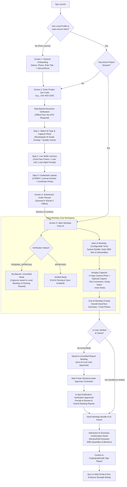

# InSite Assurance: Mobile Application Architecture & End-to-End Implementation Guide

## 1. Executive Summary & Architectural Principles

The **InSite Assurance** mobile client (`@insite/mobile`) is an offline-first field evidence, identity assurance, and daily site reporting application built with **React Native (Expo SDK 52)** and **TypeScript**. It is engineered specifically for Nigerian infrastructure and construction corridors where network connectivity is intermittent, mobile hardware varies widely (including budget Android devices with lower-grade camera sensors), and statutory liability requires strict provenance between contractor self-reports and independent monitor inspections.

### Core Architectural Tenets
1. **Device-First Identity (`expo-secure-store`):** Field personnel enter their personal profile (Full Name, Phone Number, Professional Title) once upon initial app launch. This profile is persisted in hardware-backed encrypted storage on the device and reused across project join codes.
2. **Offline-First Assurance Onboarding (No Geotagging Required for Verification):** Contractors can redeem a project join code and complete their 3-step identity and competence assurance workflow (ID capture with template overlay, live oval selfie with head-turn liveness, and COREN/professional credential upload) from anywhere (home, head office, or transit) before arriving onsite. All verification artifacts queue locally if offline.
3. **Non-Blocking Unverified Access with Deferred AI Parsing (Cost & Integrity Protection):** After submitting verification documents, the user sees an "Under Review" screen that they can dismiss to enter the main Chat UI immediately. While in `PENDING_APPROVAL` status:
   - A persistent **"Verification Pending Review"** banner is displayed at the top of the workspace.
   - Intraday photos, notes, and end-of-day reports are captured and saved into a **`STAGED_UNVERIFIED` backlog**.
   - **Zero AI inference or web reconciliation calls are triggered** while unverified. This prevents wasted Whisper/LLM API spend and ensures unauthorized or rejected users never pollute project reconciliation baselines.
   - Once approved by the Independent Monitor or Lender on the web portal, an in-app notification alerts the user to review their backlog, trigger AI extraction, confirm the structured summary, and submit.
4. **Workday-Driven Chat UI & Batch AI Extraction:**
   - Project workday start and end times (e.g., `07:30` to `17:00 WAT`) are configured on the Web Portal.
   - At workday start, the chat displays an automated **Morning Deliverable Brief** detailing the scheduled WBS item(s), target quantities, and any Mandatory Visual Hold-Point requirements.
   - Throughout the day, the engineer snaps live in-app camera photos (with optional captions and hardware GPS/chainage sealing) and posts text/voice notes into the chat timeline.
   - At workday end, the user records their overall wrap-up update and submits the full workday bundle for AI parsing (when online and verified), followed by a **Mandatory Human Confirmation** step before the report is committed to the web portal.
5. **High-Priority Incident & Whistleblowing Escalation (`!` Header Action):** A dedicated top-right header action opens a structured form for emergencies, critical site delays, material failures, or confidential whistleblowing.

---

## 2. Alignment with Project Context & Recommended MVP Additions

### 2.1 Verification Against `project_context_current.md`
| Project Context Requirement | How This Mobile Architecture Satisfies It |
| :--- | :--- |
| **3-Tier Provenance Segregation (`-INS`, `-COW`, `-CON`)** | Join codes bind the session to `MONITOR_INSPECTOR`, `INDEPENDENT_RESIDENT`, or `CONTRACTOR_ENGINEER`. Contractor codes enforce the 3-step Assurance Verification flow; Monitor/Clerk codes fast-track or use streamlined credential binding. |
| **Anti-Spoofing & Live Camera Enforcement `[S26]`** | Site evidence photos must originate from the in-app camera component (`SiteEvidenceCameraModal`). System gallery imports are disabled for site progress logs. Hardware GPS, accuracy, mock-location flags, and SHA-256 hashes are sealed at shutter press. |
| **Linear Corridor Chainage (`KM X+YYY`) & Radial Geofencing** | The local `geofenceService` evaluates every site photo against the cached project GeoJSON (polyline buffer or point radius) offline and stamps the chainage label onto the chat bubble. |
| **Nigerian Accent & Pidgin ASR Error Mitigation `[S20]`** | End-of-day voice notes and intraday logs parsed by the AI require explicit human sign-off (`ConfirmAiSummarySheet`) where quantities and units can be edited prior to final submission. |
| **Mandatory Visual Hold-Points `[S27]`** | The Morning Brief highlights whether the active WBS item has a mandatory pre-pour Hold-Point instruction. |

### 2.2 Recommended High-Value MVP Enhancements
To make the user flow seamless in real-world construction conditions, the following 5 targeted enhancements are incorporated into the architecture:

1. **Camera Quality & Glare/Blur Guardrails for Budget Android Phones:**
   - In addition to visual SVG template overlays (ID card frame and oval face mask), the camera module enforces auto-focus lock, high-resolution capture preset, torch/flash toggle for dim site interiors, and a lightweight file-size/exposure sanity check that prompts a retake if an image is likely pitch-black or severely blurred.
2. **Hold-Point Pre-Pour Gatekeeper Warning:**
   - If the day's scheduled WBS item is flagged as a **Mandatory Visual Hold-Point** (e.g., inspecting reinforcement steel before pouring concrete), a sticky sub-banner reminds the engineer inside the chat. If they attempt to submit an End-of-Day report without a Hold-Point tagged photo, the app surfaces a non-blocking warning so they do not accidentally trigger a payment holdback.
3. **Quick WBS Task Switcher in Chat Composer:**
   - While the Morning Brief sets the primary WBS item for the day, site teams frequently pivot to secondary WBS tasks due to weather or material delays. A compact WBS pill above the chat input lets the engineer switch or tag which BOQ item a photo or comment belongs to.
4. **Actionable In-App Notification Center (Backlog Release + Monitor Queries + Verification Retry):**
   - Beyond notifying the user when their verification is approved and unlocking their report backlog, the notification sheet also surfaces:
     - **Verification Rejection / Retake Requests:** Allows a contractor whose ID photo was rejected for blurriness to re-run just Step 1 without losing their queued chat logs.
     - **Monitor Discrepancy Queries:** Alerts the engineer when the QS Monitor queries a specific BOQ line item so they can snap a clarifying photo directly.
5. **Multi-Project Workspace Switcher:**
   - Because personal onboarding is stored locally in `expo-secure-store`, an engineer or visiting inspector working across two facilities can tap the header title to switch between joined project chat workspaces or add a new project code.

---

## 3. End-to-End Mobile User Flow & State Machine



---

## 4. Modular Directory & File Architecture (`mobile/src/`)

To avoid monolithic screens and ensure high maintainability, the mobile codebase is organized into domain-driven, single-responsibility modules:

```text
mobile/
├── App.tsx                                   # Root provider wrapper & navigation router
├── package.json                              # Dependencies (expo-camera, expo-secure-store, etc.)
└── src/
    ├── types/
    │   ├── mobile.types.ts                   # Local device profile, chat message, workday bundle, incident types
    │   └── navigation.types.ts               # Screen route params & state machine types
    ├── config/
    │   ├── apiConfig.ts                      # Axios/Fetch instance, base URL, timeout, auth headers
    │   └── theme.ts                          # Standardized design tokens matching Web Portal brand variables
    ├── storage/
    │   ├── secureProfileStore.ts             # expo-secure-store wrapper for user profile, deviceId, signing keys
    │   ├── sqliteDatabase.ts                 # SQLite connection & table migrations (projects, chat_messages, reports, incidents, notifications)
    │   ├── repositories/
    │   │   ├── sessionRepository.ts          # CRUD for joined projects & assurance verification state
    │   │   ├── chatTimelineRepository.ts     # CRUD for daily WBS briefings, intraday photos, text/voice bubbles
    │   │   ├── workdayReportRepository.ts    # CRUD for queued/unverified workday bundles & AI extraction drafts
    │   │   └── incidentRepository.ts         # CRUD for emergency / whistleblowing / delay reports
    │   └── syncEngine.ts                     # Network listener & background queue processor (verification -> backlog -> AI -> confirm)
    ├── services/
    │   ├── cameraQualityService.ts           # Image compression, SHA-256 hashing, exposure/blur heuristic check
    │   ├── geofenceService.ts                # Offline point-in-radius & polyline chainage (KM X+YYY) calculator
    │   └── workdaySchedulerService.ts        # Evaluates project workdayStart/workdayEnd to trigger Morning Brief & EOD prompt
    ├── hooks/
    │   ├── useDeviceProfile.ts               # Reads/writes first-time onboarding profile from SecureStore
    │   ├── useProjectSession.ts              # Manages active project, assurance status polling, and project switching
    │   ├── useWorkdayChat.ts                 # Manages current day's chat messages, morning brief, and EOD state
    │   ├── useOfflineSync.ts                 # Tracks connectivity, pending outbox count, and unverified backlog count
    │   └── useNotifications.ts               # Manages in-app notifications (verification approved, backlog ready, queries)
    ├── components/
    │   ├── common/
    │   │   ├── AppHeader.tsx                 # Top bar with Project title, Notification bell, and "!" Incident button
    │   │   ├── UnverifiedBanner.tsx          # Sticky top banner when assuranceStatus === 'PENDING_APPROVAL'
    │   │   ├── StatusBadge.tsx               # Standardized mobile pill badge (no icons, no wrap)
    │   │   └── PrimaryButton.tsx             # Consistent action button with loading/disabled states
    │   ├── camera/
    │   │   ├── IdCardCameraViewfinder.tsx    # Step 1 Camera with rectangular ID card alignment frame & tips
    │   │   ├── OvalSelfieViewfinder.tsx      # Step 2 Camera with oval face mask & interactive head-turn prompts
    │   │   └── SiteEvidenceCameraModal.tsx   # Intraday in-app camera with GPS lock, WBS tag, and optional caption input
    │   ├── chat/
    │   │   ├── MorningDeliverableCard.tsx    # System bubble at start of workday showing WBS item & Hold-Point rules
    │   │   ├── ChatBubbleItem.tsx            # Renders photo+caption, text comment, or voice note bubble with provenance
    │   │   ├── EndOfDayPromptCard.tsx        # Interactive card prompting final workday wrap-up & submission
    │   │   ├── WbsQuickSelectorBar.tsx       # Compact WBS task pill bar above composer
    │   │   └── ChatComposerBar.tsx           # Bottom bar: In-App Camera trigger, text input, voice recorder, EOD button
    │   └── modals/
    │       ├── ConfirmAiSummarySheet.tsx     # Modal sheet to inspect, edit, and sign AI-extracted quantities
    │       ├── BacklogReviewModal.tsx        # Modal listing queued unverified reports ready for AI parsing after approval
    │       ├── NotificationsSheet.tsx        # Slide-up in-app notification center
    │       └── SpecialIncidentModal.tsx      # "!" Header modal for Emergency, Whistleblowing, or Critical Delay
    └── screens/
        ├── OnboardingProfileScreen.tsx       # Screen 1: First-time Name, Phone, Title setup (SecureStore)
        ├── EnterProjectCodeScreen.tsx        # Screen 2: Enter Join Code + list of existing joined projects
        ├── AssuranceVerificationWizard.tsx   # Screen 3: 3-Step Offline-First Verification (ID -> Selfie -> Credentials)
        ├── VerificationUnderReviewScreen.tsx # Screen 4: "Submission Under Review" with "Proceed to Workspace" action
        └── WorkdayChatScreen.tsx             # Screen 5: Main Chat UI, intraday captures, EOD wrap-up, & header actions
```

---

## 5. Data Models, Database Schema Updates & API Contracts

To support the complete flow end-to-end across **Database (Prisma) -> Server (Express) -> Web (`@insite/web`) -> Mobile (`@insite/mobile`)**, the following schema and API extensions are defined.

### 5.1 Prisma Schema Additions (`server/prisma/schema.prisma`)

#### 1. Configurable Workday Hours & Daily WBS Focus on `Project`
Add configurable workday start/end times to the `Project` model so the Independent Monitor can configure them on the Web Portal:
```prisma
model Project {
  // ... existing fields ...
  workdayStartTime      String           @default("08:00") // 24h format HH:mm (WAT)
  workdayEndTime        String           @default("17:00") // 24h format HH:mm (WAT)
  activeDailyBoqItemId  String?          @db.Uuid          // Optional primary WBS focus for the workday
  // ...
  incidentReports       IncidentReport[]
}
```

#### 2. New `IncidentReport` Model (For the `!` Header Escalation Flow)
```prisma
enum IncidentCategory {
  EMERGENCY_SAFETY
  WHISTLEBLOWING_FRAUD
  CRITICAL_DELAY_BLOCKER
  MATERIAL_QUALITY_FAILURE
  ENVIRONMENTAL_HAZARD
  SECURITY_INCIDENT
}

enum IncidentSeverity {
  LOW
  MEDIUM
  HIGH
  CRITICAL
}

model IncidentReport {
  id                String           @id @default(uuid()) @db.Uuid
  projectId         String           @db.Uuid
  fieldSessionId    String           @db.Uuid
  clientIncidentId  String           @unique @db.Uuid
  category          IncidentCategory
  severity          IncidentSeverity @default(HIGH)
  isConfidential    Boolean          @default(false) // If true, hidden from Contractor portal users
  title             String
  description       String
  voiceTranscript   String?
  mediaUrls         Json             @default("[]")  // Array of captured photo URLs/hashes
  latitude          Float?
  longitude         Float?
  status            String           @default("OPEN") // OPEN | INVESTIGATING | RESOLVED
  createdAtDevice   DateTime
  syncedAtServer    DateTime         @default(now())

  project           Project           @relation(fields: [projectId], references: [id], onDelete: Cascade)
  fieldSession      FieldAgentSession @relation(fields: [fieldSessionId], references: [id], onDelete: Restrict)

  @@index([projectId, category])
  @@index([projectId, status])
}
```

### 5.2 Local Mobile Storage Schemas

#### A. `expo-secure-store` (`secureProfileStore.ts`)
Stores device-level identity once so the user never re-types their details unless they edit their profile:
```typescript
export interface LocalDeviceAgentProfile {
  deviceId: string;              // Generated UUIDv4 on first install
  deviceSecretKey: string;       // 256-bit hex secret for HMAC/SHA-256 capture signing
  fullName: string;              // e.g. "Engr. Chukwuma Okeke"
  phoneNumber: string;           // e.g. "+234 803 555 0192"
  RoleTitle?: string;            // e.g. "Senior Site Engineer"
  corenOrLicenseNumber?: string; // Cached for convenience across projects
  onboardedAt: string;           // ISO timestamp
}
```

#### B. Local SQLite Tables (`sqliteDatabase.ts`)
1. **`local_project_sessions`**:
   - `sessionId`, `projectId`, `projectCodePrefix`, `projectName`, `joinCode`, `independenceTier`
   - `assuranceStatus`: `'NOT_STARTED' | 'QUEUED_OFFLINE' | 'PENDING_APPROVAL' | 'APPROVED' | 'REJECTED'`
   - `verificationPayloadJson`: Stores local file URIs and metadata for Step 1 (`idType`, `localIdPhotoUri`), Step 2 (`localSelfieUri`, `livenessPassed`, `headTurnLeftAt`, `headTurnRightAt`), and Step 3 (`licenseNumber`, `experienceSummary`, `localCredentialUri`).
   - `workdayStartTime` (`"08:00"`), `workdayEndTime` (`"17:00"`), `baselinePackJson`.

2. **`local_chat_messages`**:
   - `id` (UUID), `projectId`, `workdayDate` (`YYYY-MM-DD`), `boqItemId`, `wbsCode`
   - `senderType`: `'SYSTEM_MORNING_BRIEF' | 'FIELD_AGENT' | 'SYSTEM_EOD_PROMPT' | 'AI_CO_PILOT' | 'MONITOR_ALERT'`
   - `messageType`: `'MORNING_BRIEF' | 'PHOTO_CAPTION' | 'TEXT_COMMENT' | 'VOICE_NOTE' | 'EOD_SUMMARY' | 'AI_CONFIRMATION'`
   - `textCaption`, `localMediaUri`, `localAudioUri`, `audioDurationSec`
   - `latitude`, `longitude`, `gpsAccuracyMeters`, `chainageLabel`, `isWithinGeofence`, `sha256Hash`
   - `workdayReportId` (foreign key linking intraday messages to their parent daily report bundle)
   - `createdAtDevice`

3. **`local_workday_reports`** (Manages the Unverified Backlog & AI Confirmation Lifecycle):
   - `id` (UUID), `projectId`, `workdayDate` (`YYYY-MM-DD`), `primaryBoqItemId`
   - `overallTextSummary`, `overallAudioUri`
   - `status`:
     - `'IN_PROGRESS'` (Workday still active)
     - `'STAGED_UNVERIFIED'` (Submitted by user while `assuranceStatus !== 'APPROVED'`; held locally to save AI cost)
     - `'QUEUED_FOR_AI'` (User is `APPROVED`; waiting for network to call `/evidence/extract-workday`)
     - `'AWAITING_USER_CONFIRMATION'` (AI extraction returned; user must review and tap Confirm)
     - `'CONFIRMED_QUEUED_SYNC'` (User confirmed; waiting to push final signed payload to server)
     - `'SYNCED_TO_PORTAL'` (Completed and rated on Web Portal)
   - `aiExtractedSummary`, `aiExtractedQuantitiesJson`, `aiExtractedBlockersJson`
   - `wasEditedByUser`, `confirmationSignatureHash`

4. **`local_incident_reports`**:
   - `id`, `projectId`, `category`, `severity`, `isConfidential`, `title`, `description`, `localPhotoUrisJson`, `syncStatus` (`'QUEUED' | 'SYNCED'`).

5. **`local_notifications`**:
   - `id`, `projectId`, `type` (`'VERIFICATION_APPROVED' | 'VERIFICATION_REJECTED' | 'BACKLOG_READY' | 'MONITOR_QUERY' | 'EOD_REMINDER'`)
   - `title`, `body`, `relatedEntityId`, `isRead`, `createdAt`.

---

## 6. Detailed Specification of Each Mobile Screen & Component

### 6.1 Screen 1: First-Time General Onboarding (`OnboardingProfileScreen.tsx`)
- **Trigger:** Shown only when `useDeviceProfile()` detects no profile in `expo-secure-store`.
- **Fields:**
  - `Full Name` (Required)
  - `Mobile Phone Number` (Required, Nigerian format `+234...` or `080...`)
  - `Default Role / Designation` (Optional, e.g., Site Engineer, Resident Clerk of Works)
- **Behavior:**
  - Generates a persistent cryptographic `deviceId` and `deviceSecretKey` via `expo-crypto`.
  - Saves to `expo-secure-store`.
  - Navigates immediately to `EnterProjectCodeScreen`.

### 6.2 Screen 2: Project Code Entry (`EnterProjectCodeScreen.tsx`)
- **UI Layout:**
  - Greeting banner displaying the user's saved name and phone from `SecureStore` (with a small "Edit Profile" link).
  - Clean input card for the **Project Join Code** (e.g., `LKK-402-CON`, `ABJ-108-CON`, `LKK-402-COW`) with a prominent **Submit** button below.
  - Quick demo fill pills for testing (`Contractor Unverified Flow`, `Monitor Inspector Flow`).
  - If the user has previously joined projects stored in SQLite, displays a **"Your Active Projects"** list below so they can jump back into an existing chat workspace.
- **Offline-Resilient Code Resolution:**
  - If online, validates the code against `POST /api/v1/auth/join-code/validate` (or fetches the baseline pack) and initializes the local project session.
  - If offline, validates the code format (`XXX-NNN-CON` / `COW` / `INS`), creates a provisional offline session, and proceeds directly into the **Assurance Verification Wizard**.

### 6.3 Screen 3: Step-Based Assurance Verification Wizard (`AssuranceVerificationWizard.tsx`)
- **Design Rules:**
  - Strictly offline-first.
  - **Does NOT request or require GPS/geofence coordinates**, allowing contractors invited remotely to complete onboarding prior to site arrival.
  - Progress indicator bar at top: `Step 1 of 3: Valid ID` -> `Step 2 of 3: Live Selfie` -> `Step 3 of 3: Credentials`.

#### Step 1: ID Type Selection & Guided Camera (`IdCardCameraViewfinder.tsx`)
- **ID Type Picker:** Radio pills for:
  - `National ID (NIN Slip / Card)`
  - `Driver's License (FRSC)`
  - `Permanent Voter's Card (PVC)`
  - `International Passport`
- **Template Overlay Viewfinder:**
  - Full-screen camera modal with a translucent dark mask and a **high-contrast rectangular cutout** (`aspectRatio: 1.586`, standard ID-1 card ratio) with corner alignment brackets and a subtle horizontal placement guide for the ID photo zone and text zone.
  - **Low-End Phone Mitigations:**
    - Built-in **Flash / Torch Toggle** for poorly lit rooms.
    - On-screen guidance: *"Place ID flat on a surface. Align all 4 corners inside the frame and avoid overhead bulb glare."*
    - Instant post-capture preview showing sharpness/brightness check with `[Use Clear Photo]` or `[Retake Photo]` buttons.

#### Step 2: Live Selfie with Oval Viewfinder & Head-Turn Liveness (`OvalSelfieViewfinder.tsx`)
- **Oval Face Framing:**
  - Front-facing camera modal with an **oval SVG cutout** covering ~65% of the vertical frame height to ensure the contractor positions their face close enough and centered.
- **Interactive 3-Stage Liveness State Machine:**
  1. `ALIGN_FACE`: *"Position your face inside the oval frame"* (Border: White/Blue).
  2. `TURN_LEFT`: *"Slowly turn your head slightly to the LEFT"* (Animated directional indicator; records frame/angle confirmation).
  3. `TURN_RIGHT`: *"Now turn your head slightly to the RIGHT"* (Animated directional indicator; records frame/angle confirmation).
  4. `COMPLETE`: Oval border turns Emerald Green (`#10B981`), captures the final centered high-clarity selfie, and seals the liveness score and timestamp.

#### Step 3: Credentials & Competence Evidence (`CredentialsStep`)
- **Inputs:**
  - **Credential Type:** `COREN`, `QSRBN`, `ARCON`, `CORBON`, `OTHER_TECHNICAL_CERT`.
  - **Registration / License Number:** e.g., `COREN R.49201`.
  - **Years of Experience & Relevant Scope Summary:** Short text input (e.g., *"8 years civil engineering; box culverts and highway drainage"*).
  - **Credential Document / Certificate Photo:** Captures a photo of the practicing license or certificate using the document viewfinder.
- **Completion Action:**
  - Tapping **`Submit Verification Package`** writes the entire verification bundle to SQLite (`local_project_sessions`), queues it in `syncEngine` for upload, and transitions to `VerificationUnderReviewScreen`.

### 6.4 Screen 4: Submission Under Review (`VerificationUnderReviewScreen.tsx`)
- **UI Content:**
  - Status card showing that the ID, live selfie liveness check, and credentials have been packaged for review by the **Independent Project Monitor / Lender**.
  - Clear explanation of **Unverified Queue Mode**:
    - *"You can proceed to the project workspace now and begin logging daily site photos and updates."*
    - *"While your verification is pending approval, your daily reports will be securely queued on your device and will be parsed and submitted once your account is verified."*
- **Actions:**
  - Primary Button: **`Continue to Project Chat Workspace`** (Dismisses the review screen and opens `WorkdayChatScreen`).

### 6.5 Screen 5: Main Workday Chat UI (`WorkdayChatScreen.tsx`)

#### A. Header Bar (`AppHeader.tsx`)
- **Left:** Project Code & Name (`LKK-402 · Lekki-Epe Dualization`) + tap to switch project.
- **Right Action Icons:**
  1. **Notification Bell Icon** with unread badge count (opens `NotificationsSheet.tsx`, highlighting when verification is approved and how many backlog reports need confirmation).
  2. **Exclamation Icon Button (`!`)** in high-contrast amber/rose tint (opens `SpecialIncidentModal.tsx` for Emergency, Whistleblowing, or Critical Delay reporting).

#### B. Top Unverified Banner (`UnverifiedBanner.tsx`)
- Rendered whenever `session.assuranceStatus === 'PENDING_APPROVAL'` or `'QUEUED_OFFLINE'`.
- Displays:
  - *"Account Verification Pending: Your daily updates are saved to your local backlog ({backlogCount} queued). AI parsing and portal submission will unlock once approved."*
  - Includes a **`[Check Status]`** button (or demo **`[Simulate Monitor Approval]`** button in dev/demo mode so evaluators can test the full approval-to-backlog confirmation transition on the spot).

#### C. Chat Timeline (`FlatList` / `ScrollView` of Chronological Workday Events)
1. **Beginning-of-Workday System Message (`MorningDeliverableCard.tsx`):**
   - Automatically injected at the start of the workday (configured via `workdayStartTime`, e.g., `08:00 WAT`).
   - Displays:
     - **Workday Window:** `08:00 - 17:00 WAT`
     - **Scheduled WBS Item:** e.g., `WBS 02.03.1: Cast in-situ reinforced concrete box culvert (2.5m x 2.0m)`
     - **Expected Deliverables:** Target daily progress, unit of measurement (`m3`), and required quality checks.
     - **Mandatory Hold-Point Callout (if `isHoldPoint === true`):** Highlighted badge and rule (e.g., *"Pre-pour reinforcement & blinding photo required before concrete placement"*).
2. **Intraday Capture Bubbles (`ChatBubbleItem.tsx`):**
   - **In-App Camera Photo Bubble:** Displays thumbnail, optional user caption, WBS badge (`02.03.1`), hardware timestamp (`11:24 WAT`), and offline geofence badge (`KM 14+200 · Within Corridor`).
   - **Text Comment / Delay Bubble:** Displays timestamped site note (e.g., *"Granite delivery truck stuck in traffic at Ajah; arrived 2 hours late"*).
   - **Voice Note Bubble:** Displays audio waveform/duration bar and language tag.
3. **End-of-Workday Wrap-Up Card (`EndOfDayPromptCard.tsx`):**
   - Appears automatically when local time reaches `workdayEndTime` (or when the user taps **"End-of-Day Update"** in the composer).
   - Prompts the engineer to record an overall voice or text summary of the day's completed work and attach any final photos.
   - Primary CTA inside card:
     - If user is **Verified**: **`Submit Day's Report for AI Parsing`**
     - If user is **Unverified**: **`Queue Day's Report in Backlog (Awaiting Verification)`**

#### D. AI Extraction & Mandatory Confirmation Flow (`ConfirmAiSummarySheet.tsx` & `BacklogReviewModal.tsx`)
- **Scenario A (User is Already Verified):**
  - Tapping **`Submit Day's Report`** sends the day's intraday photos, captions, comments, and EOD summary to the AI parser as soon as network is available.
  - The AI returns a structured summary (Extracted Quantities per WBS item, Site Blockers, Vision Observations, and Voice Transcript).
  - `ConfirmAiSummarySheet` opens: the user verifies or edits the quantities and taps **`Confirm & Send to Portal`**.
  - The server immediately evaluates the confirmed report against the BOQ and active IPC claims to update the **Evidence Strength Rating**.
- **Scenario B (User was Unverified when capturing, then gets Approved):**
  - While unverified, submitted workday reports sit in `status = 'STAGED_UNVERIFIED'` (no AI call made).
  - When the Monitor/Lender approves the contractor on the Web Portal, `useProjectSession` detects `assuranceStatus === 'APPROVED'` and triggers an **In-App Notification**: *"Verification Approved! You have {N} queued workday report(s) ready to parse and confirm."*
  - Tapping the notification (or the banner) opens `BacklogReviewModal.tsx`.
  - The user taps **`Parse & Confirm Backlog Reports`**, which runs the AI parser on each queued workday bundle, shows the `ConfirmAiSummarySheet` for human confirmation, and submits the confirmed evidence to the Web Portal.

#### E. Special Incident / Escalation Modal (`SpecialIncidentModal.tsx` via `!` Icon)
- **Triggered by:** Tapping the `!` icon at the top right of the Chat UI header.
- **Form Fields:**
  1. **Category Selector:**
     - `Emergency / Site Safety`
     - `Whistleblowing / Fraud / Material Substitution`
     - `Critical Schedule Delay / Blocker`
     - `Material Quality / Lab Failure`
     - `Security / Community Disruption`
  2. **Confidentiality Toggle:** Auto-enabled when `Whistleblowing` is selected (*"Keep identity confidential from Main Contractor; route directly to Independent Monitor & Lender"*).
  3. **Description:** Text input + optional voice recording.
  4. **In-App Camera Attachments:** Up to 3 live photos taken with the in-app camera.
- **Submission:** Saved to SQLite `local_incident_reports` and synced to `POST /api/v1/projects/:id/incidents`, surfacing immediately in the Web Portal's `Notifications.tsx` bell menu and Audit Ledger.

---

## 7. Web Portal & Backend Integration Touchpoints

To ensure full end-to-end continuity between the Web Portal and the Mobile App:

1. **Web Portal: Configurable Workday Schedule & Daily WBS Focus:**
   - **Where:** `PortfolioDashboardPage.tsx` (New Project Modal) and `SettingsPage.tsx` (Project Governance Settings).
   - **Fields Added:** `Workday Start Time` (default `08:00`), `Workday End Time` (default `17:00`), and `Active Daily WBS Item` selector.
   - **Flow:** Saved to `Project` table in PostgreSQL -> included in `MobileBaselinePack` returned to the mobile app -> read by `workdaySchedulerService.ts` on mobile to render the Morning Brief and End-of-Day prompt.

2. **Server API Endpoints (`server/src/modules/projects/` & `evidence/`):**
   - `POST /api/v1/auth/join-code` — Accepts join code, device profile from `SecureStore`, and the 3-step verification package (`idDocumentType`, `idDocumentUrl`, `selfieImageUrl`, `livenessPassed`, `corenLicenseNumber`, `experienceSummary`). Sets `assuranceStatus = 'PENDING_APPROVAL'` for contractors.
   - `GET /api/v1/projects/:id/field-session/:sessionId/status` — Lightweight polling endpoint for the mobile app to check if `assuranceStatus` has transitioned from `PENDING_APPROVAL` to `APPROVED` or `REJECTED`, and to fetch any new Monitor Queries or Daily WBS updates.
   - `POST /api/v1/projects/:id/workday-reports/extract` — Guarded middleware that **rejects AI extraction requests if `fieldSession.assuranceStatus !== 'APPROVED'`**, enforcing cost savings and data integrity on the server as well as the client.
   - `POST /api/v1/projects/:id/workday-reports/:reportId/confirm` — Commits the human-confirmed AI summary, triggers the Evidence Strength Rating analyzer, and appends an entry to the Audit Ledger.
   - `POST /api/v1/projects/:id/incidents` — Ingests special incident/whistleblowing reports from the `!` modal and creates high-priority web notifications.

---

## 8. Phased Implementation Plan for `@insite/mobile`

### Phase M1: Shared Schemas, Database Migration & Server Endpoints
1. Update `shared/src/enums.ts` and `shared/src/schemas/` with `IncidentCategory`, `IncidentSeverity`, `WorkdayScheduleConfig`, and `WorkdayReportBundleSchema`.
2. Update `server/prisma/schema.prisma` (`workdayStartTime`, `workdayEndTime`, `activeDailyBoqItemId` on `Project`, plus `IncidentReport` model) and push migration.
3. Add server endpoints for session status polling, guarded workday AI extraction, and incident reporting, plus Web Portal settings inputs for workday start/end times.

### Phase M2: Local Storage Layer (`expo-secure-store` + SQLite Repositories + Sync Engine)
1. Install `expo-secure-store` and `expo-camera` in `@insite/mobile`.
2. Implement `secureProfileStore.ts` for first-time personal onboarding persistence.
3. Implement `sqliteDatabase.ts` and the 4 modular repositories (`sessionRepository`, `chatTimelineRepository`, `workdayReportRepository`, `incidentRepository`).
4. Implement `syncEngine.ts` with strict gating so `STAGED_UNVERIFIED` reports never call the AI endpoint until `assuranceStatus === 'APPROVED'`.

### Phase M3: Onboarding, Project Code & 3-Step Assurance Verification Wizard
1. Build `OnboardingProfileScreen.tsx` (Name, Phone, Title -> `SecureStore`).
2. Build `EnterProjectCodeScreen.tsx` (Code input + Submit + active project switcher).
3. Build `IdCardCameraViewfinder.tsx` (Rectangular ID overlay, flash toggle, clarity check), `OvalSelfieViewfinder.tsx` (Oval face cutout + Look Left / Look Right state machine), and `AssuranceVerificationWizard.tsx`.
4. Build `VerificationUnderReviewScreen.tsx` with dismiss-to-workspace capability.

### Phase M4: Main Workday Chat UI, Batch AI Confirmation, Backlog & Incident Reporting
1. Build `WorkdayChatScreen.tsx` with `AppHeader.tsx` (Notification bell + `!` Incident button) and `UnverifiedBanner.tsx`.
2. Build `MorningDeliverableCard.tsx`, `ChatBubbleItem.tsx`, `SiteEvidenceCameraModal.tsx` (in-app camera + optional caption), `ChatComposerBar.tsx`, and `EndOfDayPromptCard.tsx`.
3. Build `BacklogReviewModal.tsx` and `ConfirmAiSummarySheet.tsx` for post-approval backlog processing and mandatory human quantity confirmation.
4. Build `SpecialIncidentModal.tsx` for Emergency, Whistleblowing, and Critical Delay reporting, wired end-to-end to the Web Portal notification center.

