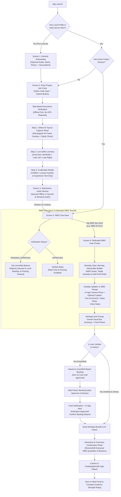

# InSite Assurance: Mobile Application Architecture & End-to-End Implementation Guide (v2.0)

## 1. Executive Summary & Architectural Principles

The **InSite Assurance** mobile client (`@insite/mobile`) is an offline-first field evidence, identity assurance, and daily site reporting application built with **React Native (Expo SDK 58)** and **TypeScript**. It is engineered specifically for Nigerian infrastructure and construction corridors where network connectivity is intermittent, mobile hardware varies widely (including budget Android devices with lower-grade camera sensors), and statutory liability requires strict provenance between contractor self-reports and independent monitor inspections.

### Core Architectural Tenets

6. **Device-First Identity (`expo-secure-store`) with Optional Avatar:**
   - On initial app launch, field personnel complete a one-time general onboarding flow: Full Name, Phone Number, Role/Title, and an **optional Profile Avatar photo** (falling back to clean user initials if skipped).
   - This profile is persisted locally on the device in `expo-secure-store`.
   - Tapping the user's **Avatar** in the app header opens the **Profile, Active Project Switcher & Demo Persona Page**, keeping the main screens uncluttered.
7. **Offline-First 3-Step Assurance Verification (No Geotagging Required, Frictionless Credentials):**
   - After entering a project join code on a clean single-input screen, contractors complete a step-based verification workflow from anywhere (office, home, or transit) before arriving onsite:
     - **Step 1 (Government ID):** Select ID type and capture a photo using a rectangular template viewfinder with alignment guides and glare/blur checks for budget Android cameras.
     - **Step 2 (Live Selfie Liveness):** Fit face inside an oval viewfinder and follow interactive prompts to look slightly left and right.
     - **Step 3 (Credentials Details Only):** Select regulatory body (e.g., `COREN`, `QSRBN`) and enter the registration/license number and brief experience summary. **No certificate photo upload is required**, ensuring the process is fast and never blocks engineers who do not have physical paper certificates on hand.
8. **Non-Blocking Unverified Access with Deferred AI Parsing (Cost & Integrity Protection):**
   - Upon finishing verification, the user sees a **"Submission Under Review"** screen that they can dismiss to enter the workspace immediately.
   - While `assuranceStatus === 'PENDING_APPROVAL'`, the workspace displays a top **"Verification Pending Review"** banner.
   - Reports submitted while unverified are stored in a **`STAGED_UNVERIFIED` backlog** and are **not sent to the AI parser** until the user's verification is approved. This saves AI compute costs and prevents invalid data from entering the project reconciliation baseline if a user is rejected.
   - When approved, a **Push Notification** and **In-App Notification** alert the user and surface their backlog of reports to confirm and submit.
9. **WBS-Dedicated Chat Inbox & Thread Architecture (Separation of Concerns):**
   - Rather than mixing multiple BOQ items in a single confusing chat stream, the main workspace uses a **WBS Chat Inbox pattern** (similar to WhatsApp/Slack channels).
   - When the user opens the project workspace, they see an inbox list of the **actionable WBS Items** for their project/tranche.
   - Tapping a WBS item opens the **dedicated Chat Thread for that specific WBS item**. Every photo, caption, delay comment, voice note, Morning Deliverable Card, and End-of-Day update inside that thread automatically belongs to that WBS item.
10. **End-to-End Push Notifications (`expo-notifications` + `push_tokens` Table):**
    - Full push notification infrastructure notifies field personnel even when the app is backgrounded or closed (e.g., Verification Approved/Backlog Ready, Monitor Discrepancy Query on a WBS item, Workday Start Morning Brief, and Workday End Wrap-Up Reminder).
11. **High-Priority Incident & Whistleblowing Escalation (`!` Header Action):**
    - An exclamation icon (`!`) at the top right of the header opens a structured reporting modal for emergencies, critical delays, or confidential whistleblowing.

---


## 2. Alignment with Project Context & UX Enhancements

| Requirement / Feature | Implementation in v2.0 Mobile Architecture |
| :--- | :--- |
| **Expo SDK 58 (Latest Toolchain)** | Targets **Expo SDK 58** with New Architecture compatibility across `expo-camera`, `expo-secure-store`, `expo-sqlite`, `expo-notifications`, `expo-location`, `expo-av`, and `expo-crypto`. |
| **WBS-Dedicated Chat Inbox UX** | Eliminates manual WBS tagging errors. Each actionable BOQ/WBS item has its own thread in `WbsInboxScreen`, showing status badges (`Scheduled Today`, `Mandatory Hold-Point`, `Open Query`) and unread counts. |
| **Push & In-App Notifications** | `PushToken` table in PostgreSQL + `ExpoPushNotificationService` on the server + `NotificationHandler` on mobile with deep-linking into specific WBS chat threads or the Backlog Review modal. |
| **Avatar-Driven Project & Demo Switcher** | Tapping the Avatar in the header opens `ProfileAndProjectsScreen`, housing profile editing, the joined project switcher, `+ Join New Project`, and the Demo Persona Switcher. |
| **Camera Quality Guardrails for Budget Phones** | Rectangular ID card overlay and oval selfie mask with torch toggle, auto-focus lock, and exposure/blur sanity checks. |
| **Nigerian Accent & Pidgin ASR Confirmation `[S20]`** | End-of-day updates parsed by the AI present an interactive confirmation card inside the WBS thread (`ConfirmAiSummarySheet`) before syncing to the web portal for Evidence Strength Rating analysis. |

---

## 3. End-to-End Mobile User Flow & State Machine



---

## 4. Modular Directory & File Architecture (`mobile/src/`)

```text
mobile/
├── App.tsx                                     # Root providers, PushNotificationBootstrap, & navigation state
├── app.json                                    # Expo SDK 58 config, camera/location/notification permissions
├── package.json                                # Expo SDK 58 dependencies
└── src/
    ├── types/
    │   ├── mobile.types.ts                     # Device profile, WBS inbox item, chat message, workday bundle, push payload
    │   └── navigation.types.ts                 # Screen routes & deep-link targets
    ├── config/
    │   ├── apiConfig.ts                        # API client, base URL, headers
    │   └── theme.ts                            # Design tokens matching Web Portal (#0C233C Navy, #00338D Primary, etc.)
    ├── storage/
    │   ├── secureProfileStore.ts               # expo-secure-store wrapper (Name, Phone, Avatar URI, deviceId, secretKey)
    │   ├── sqliteDatabase.ts                   # SQLite initialization & migrations
    │   ├── repositories/
    │   │   ├── sessionRepository.ts            # CRUD for joined projects & assurance verification state
    │   │   ├── wbsThreadRepository.ts          # Queries actionable WBS items, unread counts, & last message preview for Inbox
    │   │   ├── chatTimelineRepository.ts       # CRUD for messages inside a specific (projectId, boqItemId, workdayDate) thread
    │   │   ├── workdayReportRepository.ts      # CRUD for STAGED_UNVERIFIED backlog & AI confirmation state
    │   │   ├── incidentRepository.ts           # CRUD for "!" emergency / whistleblowing / delay reports
    │   │   └── notificationRepository.ts       # CRUD for local & push-received notification items
    │   └── syncEngine.ts                       # Connectivity listener & gated queue processor
    ├── services/
    │   ├── pushNotificationService.ts          # Token registration, Android channels, foreground/background tap handlers
    │   ├── cameraQualityService.ts             # Image compression, SHA-256 hash, exposure/blur heuristic check
    │   ├── geofenceService.ts                  # Offline radial & linear corridor chainage (KM X+YYY) calculator
    │   └── workdaySchedulerService.ts          # Evaluates configurable workdayStartTime / workdayEndTime per WBS thread
    ├── hooks/
    │   ├── useDeviceProfile.ts                 # Reads/updates SecureStore profile & avatar
    │   ├── useProjectSession.ts                # Active project session, verification status polling, project switching
    │   ├── useWbsInbox.ts                      # Returns actionable WBS threads, statuses, & backlog counts
    │   ├── useWbsChatThread.ts                 # Manages messages, morning brief, and EOD submission for a single WBS item
    │   ├── usePushNotifications.ts             # Binds expo-notifications listeners to navigation deep-linking
    │   └── useOfflineSync.ts                   # Tracks network state, outbox queue, & unverified backlog
    ├── components/
    │   ├── common/
    │   │   ├── AppHeader.tsx                   # Navy header: Avatar button (left), Title, Bell icon, "!" Incident icon (right)
    │   │   ├── AvatarButton.tsx                # Renders user photo or initials circle; taps open ProfileAndProjectsScreen
    │   │   ├── UnverifiedBanner.tsx            # Sticky top banner when assuranceStatus === 'PENDING_APPROVAL'
    │   │   ├── StatusBadge.tsx                 # Standardized pill badge (success, warning, danger, info, neutral; no icons, no wrap)
    │   │   ├── PushNotificationBootstrap.tsx   # Headless listener component mounted in App.tsx
    │   │   └── PrimaryButton.tsx               # Standardized button component
    │   ├── camera/
    │   │   ├── IdCardCameraViewfinder.tsx      # Step 1 Camera: Rectangular ID card overlay + flash + clarity check
    │   │   ├── OvalSelfieViewfinder.tsx        # Step 2 Camera: Oval face frame + Look Left / Look Right liveness prompts
    │   │   └── SiteEvidenceCameraModal.tsx     # WBS Thread Camera: Live shutter, GPS/chainage stamp, optional caption input
    │   ├── inbox/
    │   │   ├── WbsInboxRowCard.tsx             # Single WBS thread card in the inbox (WBS code, title, last msg, badge)
    │   │   └── BacklogAlertCard.tsx            # Highlighted banner card when approved user has unconfirmed backlog reports
    │   ├── chat/
    │   │   ├── MorningDeliverableCard.tsx      # Start-of-workday bubble inside WBS thread (deliverables & Hold-Point rule)
    │   │   ├── ChatBubbleItem.tsx              # Photo+caption bubble, text delay note, or voice note bubble
    │   │   ├── EndOfDayPromptCard.tsx          # End-of-workday prompt card inside WBS thread
    │   │   └── ChatComposerBar.tsx             # In-app camera button, text input, voice recorder, & EOD wrap-up trigger
    │   └── modals/
    │       ├── ConfirmAiSummarySheet.tsx       # Interactive sheet to review/edit AI-extracted quantities & sign
    │       ├── BacklogReviewModal.tsx          # Lists queued unverified workday bundles ready for AI parsing & confirmation
    │       ├── NotificationsSheet.tsx          # Slide-up notification center (Verification updates, Backlog, Queries)
    │       └── SpecialIncidentModal.tsx        # "!" Header modal for Emergency, Whistleblowing, or Critical Delay
    └── screens/
        ├── OnboardingProfileScreen.tsx         # Screen 1: First-time Avatar (optional), Name, Phone setup (SecureStore)
        ├── EnterProjectCodeScreen.tsx          # Screen 2: Clean Project Join Code input + Submit button
        ├── AssuranceVerificationWizard.tsx     # Screen 3: 3-Step Offline Wizard (ID Photo -> Oval Selfie -> License Number)
        ├── VerificationUnderReviewScreen.tsx   # Screen 4: Under Review notice with "Proceed to Workspace" button
        ├── WbsInboxScreen.tsx                  # Screen 5: Main Project Inbox listing actionable WBS item chat threads
        ├── WbsChatThreadScreen.tsx             # Screen 6: Dedicated Chat UI for a single WBS item
        └── ProfileAndProjectsScreen.tsx        # Screen 7: Opened via Avatar tap (Profile edit, Active Project Switcher, Demo Switcher)
```

---


## 5. Database Schema, Push Notification Infrastructure & API Contracts

### 5.1 Prisma Schema Additions (`server/prisma/schema.prisma`)


#### 1. Configurable Workday Hours on `Project` & Actionable WBS Flag on `BoqItem`

```prisma
model Project {
  // ... existing fields ...
  workdayStartTime      String           @default("08:00") // Configurable from Web Portal (WAT)
  workdayEndTime        String           @default("17:00") // Configurable from Web Portal (WAT)
  // ...
  incidentReports       IncidentReport[]
  pushTokens            PushToken[]
}

model BoqItem {
  // ... existing fields ...
  isScheduledToday      Boolean          @default(true)    // Surfaces in Mobile WBS Chat Inbox as active deliverable
  dailyTargetQuantity   Decimal?         @db.Decimal(14, 3)
  expectedDeliverable   String?                            // Shown in the Morning Deliverable Card at workdayStartTime
}
```


#### 2. `PushToken` Table (`push_tokens`) & `MobileNotification` Table

```prisma
enum PushPlatform {
  ANDROID
  IOS
  WEB
}

model PushToken {
  id               String            @id @default(uuid()) @db.Uuid
  fieldSessionId   String?           @db.Uuid
  userId           String?           @db.Uuid
  projectId        String?           @db.Uuid
  deviceId         String
  expoPushToken    String            @unique // e.g., "ExponentPushToken[xxxxxxxxxxxxxxxxxxxxxx]"
  platform         PushPlatform      @default(ANDROID)
  isActive         Boolean           @default(true)
  lastRegisteredAt DateTime          @default(now())
  createdAt        DateTime          @default(now())

  fieldSession     FieldAgentSession? @relation(fields: [fieldSessionId], references: [id], onDelete: Cascade)
  project          Project?           @relation(fields: [projectId], references: [id], onDelete: SetNull)

  @@index([fieldSessionId])
  @@index([projectId])
  @@index([deviceId])
  @@map("push_tokens")
}
```

#### 3. `IncidentReport` Model (For the `!` Header Escalation Flow)

```prisma
enum IncidentCategory {
  EMERGENCY_SAFETY
  WHISTLEBLOWING_FRAUD
  CRITICAL_DELAY_BLOCKER
  MATERIAL_QUALITY_FAILURE
  ENVIRONMENTAL_HAZARD
  SECURITY_INCIDENT
}

enum IncidentSeverity {
  LOW
  MEDIUM
  HIGH
  CRITICAL
}

model IncidentReport {
  id                String           @id @default(uuid()) @db.Uuid
  projectId         String           @db.Uuid
  fieldSessionId    String           @db.Uuid
  boqItemId         String?          @db.Uuid
  clientIncidentId  String           @unique @db.Uuid
  category          IncidentCategory
  severity          IncidentSeverity @default(HIGH)
  isConfidential    Boolean          @default(false) // Hidden from Contractor portal users when true
  title             String
  description       String
  mediaUrls         Json             @default("[]")
  status            String           @default("OPEN")
  createdAtDevice   DateTime
  syncedAtServer    DateTime         @default(now())

  project           Project           @relation(fields: [projectId], references: [id], onDelete: Cascade)
  fieldSession      FieldAgentSession @relation(fields: [fieldSessionId], references: [id], onDelete: Restrict)

  @@index([projectId, category])
  @@index([projectId, status])
}
```


### 5.2 Push Notification Architecture (`expo-notifications`)


1. **Client Registration (`pushNotificationService.ts`):**
   - Requests notification permissions on onboarding completion.
   - Configures high-priority Android Notification Channels:
     - `assurance-status`: Verification approvals, rejections, and backlog unlock alerts.
     - `wbs-workday`: Morning WBS Deliverable briefs (`workdayStartTime`), End-of-Day summary reminders (`workdayEndTime`), and Monitor WBS queries.
   - Obtains the `ExponentPushToken[...]` and registers it with `POST /api/v1/notifications/push-tokens` (caching locally if offline and syncing when connected).
   - Schedules local repeating workday triggers (`scheduleNotificationAsync`) based on the project's `workdayStartTime` and `workdayEndTime` so Morning Briefs and EOD prompts fire reliably even when the user is offline in the field.

2. **Server Dispatch (`server/src/modules/notifications/pushNotification.service.ts`):**
   - Triggered automatically inside server mutations:
     - **`reviewContractorVerification` (`APPROVED`):** Sends push notification _"Assurance Verification Approved! Tap to review and confirm your queued workday reports."_ with payload `{ type: 'VERIFICATION_APPROVED', projectId, openModal: 'BACKLOG_REVIEW' }`.
     - **`reviewContractorVerification` (`REJECTED`):** Sends push notification _"Verification Action Required: Please retake your ID photo."_ with payload `{ type: 'VERIFICATION_REJECTED', projectId, step: 1 }`.
     - **`raiseMonitorQuery`:** Sends push notification _"Monitor Query on WBS {wbsCode}: Tap to open chat thread and attach clarifying evidence."_ with payload `{ type: 'MONITOR_QUERY', projectId, boqItemId }`.

4. **Deep-Link Navigation Handler (`PushNotificationBootstrap.tsx`):**
   - Listens to `Notifications.addNotificationResponseReceivedListener`:
     - If `data.openModal === 'BACKLOG_REVIEW'`, switches to the project and opens `BacklogReviewModal`.
     - If `data.boqItemId` is present, opens `WbsChatThreadScreen` for that exact WBS item.

---

## 6. Screen-by-Screen Functional & UX Specification

### Screen 1: First-Time General Onboarding (`OnboardingProfileScreen.tsx`)

- **Purpose:** Collect basic device-level identity once and save to `expo-secure-store`.
- **UI Elements:**
  - **Optional Avatar Picker:** Circular avatar preview at top center. Tapping lets the user snap a quick profile picture or pick one (if skipped, displays their initials in a `#0C233C` Navy badge).
  - **Full Name Input:** e.g., `Engr. Chukwuma Okeke`
  - **Phone Number Input:** e.g., `+234 803 555 0192`
  - **Role / Title Input (Optional):** e.g., `Senior Site Civil Engineer`
  - **Continue Button:** Saves to `SecureStore` and navigates to `EnterProjectCodeScreen`.

### Screen 2: Enter Project Code (`EnterProjectCodeScreen.tsx`)

- **Purpose:** Clean, single-focus screen to enter a project join code.
- **UI Elements:**
  - Top bar with the user's **Avatar button** (tapping opens `ProfileAndProjectsScreen` where existing projects and demo persona switchers live).
  - Centered card with **Project Join Code** input (`LKK-402-CON`) and **Submit Project Code** button below.
  - Works offline-first: validates format locally if offline or fetches baseline pack if online, then launches `AssuranceVerificationWizard`.

### Screen 3: 3-Step Offline Assurance Verification (`AssuranceVerificationWizard.tsx`)

- **No Geotagging Required:** Contractors can complete this before traveling to site.
- **Step 1: Select ID Type & Guided Photo Capture (`IdCardCameraViewfinder.tsx`)**
  - Select ID type (`NIN Slip / Card`, `Driver's License`, `Permanent Voter's Card`, `International Passport`).
  - Camera viewfinder displays a crisp **rectangular ID template overlay** with corner brackets, glare/lighting tips, flash toggle, and instant clarity preview.
- **Step 2: Live Selfie with Oval Viewfinder (`OvalSelfieViewfinder.tsx`)**
  - Front camera with an **oval face cutout** requiring the user's face to fill the frame.
  - Prompts the user to **turn head slightly left, then slightly right**, sealing the live selfie upon completion.
- **Step 3: Credentials Details (`CredentialsStep`)**
  - Select Regulatory Body (`COREN`, `QSRBN`, `ARCON`, `CORBON`, `OTHER`).
  - Enter **License / Registration Number** (e.g., `COREN R.49201`).
  - Enter **Brief Experience / Competence Summary** (e.g., `8 years highway drainage & reinforced concrete supervision`).
  - **No certificate photo upload required.**

### Screen 4: Submission Under Review (`VerificationUnderReviewScreen.tsx`)

- **UI Elements:**
  - Confirmation badge showing the verification package is queued/sent to the Independent Monitor & Lender.
  - Clear explanation that the user can proceed to the project workspace immediately and log updates into their local backlog while awaiting approval.
  - Primary CTA: **`Proceed to WBS Chat Inbox`**.

### Screen 5: WBS Chat Inbox (`WbsInboxScreen.tsx`)

- **Header (`AppHeader.tsx`):**
  - **Left:** User **Avatar / Initials** (taps open `ProfileAndProjectsScreen`) + Project Code & Name (`LKK-402 · Lekki-Epe Dualization`).
  - **Right:** **Notification Bell** (with unread dot/count) + **`!` Special Incident Button**.
- **Top Unverified Banner (`UnverifiedBanner.tsx`):**
  - Shown when `assuranceStatus === 'PENDING_APPROVAL'`: _"Unverified Mode: Reports are queued locally ({N} in backlog). AI parsing will run once your verification is approved."_
- **Actionable WBS Item Chat List:**
  - Looks and feels like a modern messaging inbox. Each card represents one actionable WBS Item (e.g., `02.03.1 · Box Culvert 2.5m x 2.0m`, `01.02.4 · Earthworks & Sub-base Compaction`, `03.01.2 · Stone Pitching & Lined Drains`):
    - **WBS Code Pill & Work Item Title**
    - **Standardized Status Badge:** `Scheduled Today`, `Mandatory Hold-Point`, `Open Query`, or `Report Confirmed`
    - **Latest Message Preview:** e.g., _"Morning Brief: Target 15m3 concrete pour today..."_ or _"Photo captured at KM 14+200"_
    - **Right Meta:** Timestamp (`08:00` / `14:32`) + unread/queued indicator badge.

### Screen 6: Dedicated WBS Chat Thread (`WbsChatThreadScreen.tsx`)

- **Context-Bound:** Everything in this chat belongs strictly to the selected WBS item (e.g., `WBS 02.03.1`).
- **Beginning-of-Workday System Bubble (`MorningDeliverableCard.tsx`):**
  - Posted automatically at `workdayStartTime` (e.g., `08:00 WAT`).
  - Shows the WBS Code, Description, Today's Expected Deliverable, Unit (`m3`), and any **Mandatory Visual Hold-Point Rule**.
- **Intraday Messages (`ChatBubbleItem.tsx`):**
  - **In-App Camera Photos:** Snapped via the camera button in the composer (gallery uploads blocked). Prompts for an **optional caption** before posting into the chat with hardware GPS/chainage stamp (`KM 14+200 · Within Corridor`).
  - **Text / Voice Notes:** Quick comments throughout the day (e.g., _"Delivery truck was stuck in traffic at Ajah and arrived 90 mins late"_).
- **End-of-Workday Prompt & Submission (`EndOfDayPromptCard.tsx`):**
  - Appears at `workdayEndTime` (e.g., `17:00 WAT`) or when tapped in the composer.
  - Prompts for the overall workday update (voice note or text summary + final photos).
  - If **Verified**: Sends the WBS workday bundle to the AI parser as soon as online -> opens `ConfirmAiSummarySheet` for human quantity confirmation -> submits to Web Portal for Evidence Strength Rating.
  - If **Unverified**: Saves the WBS workday bundle into the **`STAGED_UNVERIFIED` backlog** (zero AI cost). Once verified via push/in-app notification, the user confirms and submits the backlog.

### Screen 7: Avatar Page — Profile, Project Switcher & Demo Switcher (`ProfileAndProjectsScreen.tsx`)

- Opened by tapping the **Avatar / Initials** in the header.
- **Sections:**
  1. **Engineer Profile:** Avatar photo/initials, Name, Phone, COREN License, and Edit button (`expo-secure-store`).
  2. **Active Project Switcher:** List of joined projects (`LKK-402`, `ABJ-108`) with verification status badges and a **`+ Enter New Project Join Code`** button.
  3. **Demo Persona & State Switcher:** One-tap switches for evaluators (`Unverified Contractor with Backlog`, `Newly Approved Contractor (Trigger Notification)`, `Tier 1 Monitor Inspector`).
