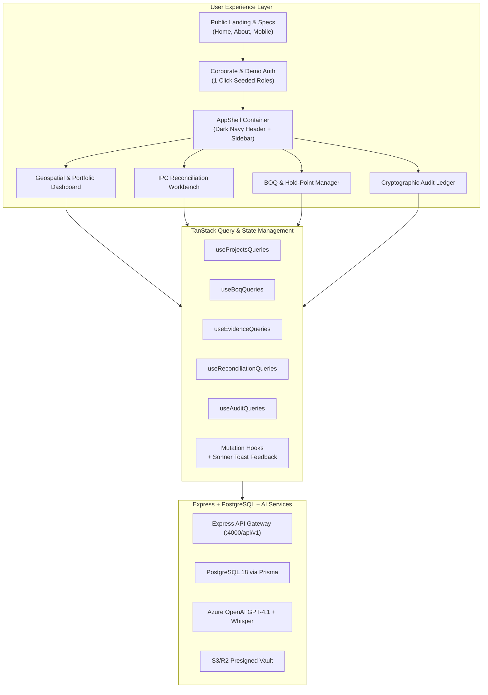
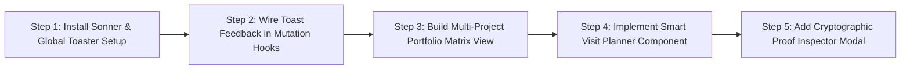

# InSite Assurance Web Application: Comprehensive Review & Enhancement Roadmap

> **Document Version:** 1.0  
> **Target Platform:** InSite Assurance Web Portal (`@insite/web`)  
> **Context References:** `project_context_current.md`, `project_context_revised.md`, KPMG Design Tokens

---

## 1. Executive Review & System Architecture Summary

The **InSite Assurance Web Application** serves as the primary cockpit for **Independent Project Monitors** (QSRBN Quantity Surveyors and COREN Engineers) and **Financiers/Guarantors** (InfraCredit, commercial project finance desks, and DFIs), while providing a segregated surface for **Main Contractors** (submitting IPC claims and answering queries).

The application is structured into three main surface tiers:

1. **Public Marketing & Documentation Layer:** (`HomePage.tsx`, `AboutPage.tsx`, `MobileAppPage.tsx`, `LoginPage.tsx`) explaining the Nigerian infrastructure context, problem validation, 7-step lifecycle flow, and verifiable citations (`[S1]` to `[S27]`).
2. **Authenticated Assurance Workspace (`AppShell.tsx`):** A floating, collapsible KPMG navy sidebar, dark navy top header bar, and dynamic workspace canvas.
3. **Domain Modules & Data Layer:** Modular API clients (`web/src/api/`), TanStack Query hooks (`web/src/queries/`), and mutation hooks (`web/src/mutations/`).

---

## 2. Comprehensive Inventory of Current Web App Capabilities

### 2.1 Authenticated Views & Modules

| View / Module                                                        | Primary Role                | Key Features Currently Implemented                                                                                                                                                                                                                                                                                                                                                                                                                                                                                                                        | Status      |
| :------------------------------------------------------------------- | :-------------------------- | :-------------------------------------------------------------------------------------------------------------------------------------------------------------------------------------------------------------------------------------------------------------------------------------------------------------------------------------------------------------------------------------------------------------------------------------------------------------------------------------------------------------------------------------------------------- | :---------- |
| **Geospatial & Portfolio Dashboard** (`PortfolioDashboardPage.tsx`)  | Monitor, Lender, Contractor | • 50% viewport OpenStreetMap Leaflet map with corridor polyline and radial circles. • Clickable evidence markers displaying chainage, thumbnail, and verification badges. • 3 KPI cards (Facility Commitment, Verified Progress %, Reconciliation Alerts). • Bottom telemetry strip: Geofence Integrity, Latest Confirmed Voice Log, Active Tranche Readiness & CPs. • "+ New Project" creation modal with Corridor vs. Radial selector.                                                                                                      | Implemented |
| **IPC Reconciliation Workbench** (`ReconciliationWorkbenchPage.tsx`) | Monitor, Lender, Contractor | • Active IPC selector with ghost tranche dropdown. • Claim vs. Evidence comparative schedule (WBS ID, description, claim %, evidence rating, corroboration tier, certified %). • Slide-over `EvidenceOverlayDrawer` with audio waveform player, Whisper Nigerian Pidgin/English transcript, and GPT-4.1 extracted summary. • Formal Monitor Dispute Query workflow and Contractor reply drawer. • Monitor Certification modal & Lender Tranche Release decision modal. • Export Valuation PDF button streaming real-time executive report. | Implemented |
| **BOQ & Hold-Points Manager** (`BoqAndHoldPointsPage.tsx`)           | Monitor, Contractor         | • Spreadsheet (.xlsx / .csv) ingestion. • AI Lump-Sum opacity screening (flagging items lacking unit breakdown). • Role-segregated 6-character Mobile Join Codes (`-INS`, `-COW`, `-CON`). • Interactive Toggle for Mandatory Visual Hold-Points. • "Confirm All Tranche Mappings" batch action. • Slide-over BOQ Item Inspector drawer with rate, total budget, and hold-point rules.                                                                                                                                                     | Implemented |
| **Audit Ledger Page** (`AuditLedgerPage.tsx`)                        | Monitor, Lender             | • Immutable hash-chained governance event log. • Cryptographic verification status of the SHA-256 chain. • Detailed columns: Timestamp, Actor & Role, Action Badge, Governance Summary. • Segregated: strictly hidden from Main Contractor users.                                                                                                                                                                                                                                                                                                | Implemented |

### 2.2 Public Pages & Cross-Cutting Architecture

| Component / Page                                             | Purpose & Core Capabilities                                                                                                                                                    |
| :----------------------------------------------------------- | :----------------------------------------------------------------------------------------------------------------------------------------------------------------------------- |
| **Home Page** (`HomePage.tsx`)                               | Value proposition, "Auditor Co-Pilot" principle explanation, interactive visual platform preview mockups, audio player preview, and target segment matrix.                     |
| **Specification & Context Page** (`AboutPage.tsx`)           | 7-step End-to-End Capital Project Lifecycle, 27 interactive superscripted citations (`[S1]`–`[S27]`) with hover tooltips, high-contrast dark navy sidebar, and zero em dashes. |
| **Mobile App Showcase** (`MobileAppPage.tsx`)                | Offline-first capabilities, phone frame mockup, live chainage snapping explanation, and APK/TestFlight download callouts.                                                      |
| **Auth & Quick-Switch** (`LoginPage.tsx`)                    | Full-viewport split-screen, 1-click quick-fill seeded accounts for Independent Monitor (QSRBN), Lender (InfraCredit), and Contractor (J&S Civil Eng.).                         |
| **Design System Tokens** (`index.css`, `tailwind.config.js`) | Centralized color variables (`--color-brand-primary`, `--color-brand-navy`, `--color-brand-pacific`, `--color-brand-sky`), zero monospace fonts, Inter typography.             |

---

## 3. Identified Gaps, Missing Flows & Recommended Additions

Based on the project context specifications (`project_context_current.md` and `project_context_revised.md`) and standard construction finance workflows, the following high-value features, flows, and views are recommended for implementation:

### 3.1 Toast Notification Feedback System (`sonner`)

> [!IMPORTANT]
> Currently, the web app relies on local component `statusMessage` state banners in pages, which require manual dismissal and do not provide global feedback across asynchronous mutations.

**Proposed Implementation:**

1. Install `sonner` in `@insite/web`.
2. Mount `<Toaster position="top-right" richColors closeButton theme="light" />` in `App.tsx`.
3. Wire rich toast notifications into the `onSuccess` and `onError` blocks of all TanStack Query mutation hooks:

| Mutation Hook                    | Trigger Event               | Toast Notification Message                                                                             |
| :------------------------------- | :-------------------------- | :----------------------------------------------------------------------------------------------------- |
| `useCreateProjectMutation`       | Project Created             | `toast.success("Project baseline registered successfully with 3 mobile join codes.")`                  |
| `useUploadBoqMutation`           | BOQ Ingestion               | `toast.success("Ingested {count} BOQ items ({holdPoints} Hold-Points, {opaque} Lump Sums screened).")` |
| `useUpdateBoqMappingsMutation`   | Tranche / Hold-Point Mapped | `toast.success("Updated BOQ tranche mapping & Hold-Point rules.")`                                     |
| `useSubmitIpcMutation`           | Contractor IPC Submission   | `toast.success("IPC #{number} submitted. AI reconciliation initiated against field logs.")`            |
| `useReconcileIpcMutation`        | Run AI Reconciliation       | `toast.success("AI Evidence Strength Ratings updated against verified site logs.")`                    |
| `useCreateMonitorQueryMutation`  | Monitor Raises Query        | `toast.warning("Formal dispute query issued to Main Contractor.")`                                     |
| `useRespondMonitorQueryMutation` | Contractor Replies          | `toast.info("Contractor clarification recorded on dispute query.")`                                    |
| `useCertifyValuationMutation`    | Valuation Certified         | `toast.success("Disbursement Valuation Report certified & signed by Independent Monitor.")`            |
| `useDecideTrancheMutation`       | Lender Decision             | `toast.success("Lender Tranche Release decision committed to cryptographic ledger.")`                  |
| `quickSwitchDemoAccount`         | Role Switched               | `toast.info("Active workspace switched to {role} ({name}).")`                                          |

---

### 3.2 Recommended Additional Views & Flow Enhancements

#### A. Contractor Assurance Onboarding & Verification Flow

- **Target Persona:** Contractor Site Engineers (Mobile) & Independent Monitors / Lenders (Web Portal).
- **Assurance Rationale:** Gives lenders and independent monitors complete confidence that the on-site engineer submitting progress claims is verified, licensed, and competent, preventing unauthorized access.
- **Workflow:**
  1. **Mobile Contractor Entry:** When an engineer enters a `-CON` project join code, they must upload:
     - Government-issued photo ID (National ID / Driver's License / Passport).
     - Live selfie with liveness detection (viewfinder prompting slight head turn).
     - Professional credentials and project experience documentation (e.g. COREN / NSE registration).
  2. **Pending Approval Gate:** The contractor's mobile session remains in `PENDING_APPROVAL` status and cannot submit logs or claims yet.
  3. **Web Portal Approval Queue:** An in-app notification alerts the Independent Monitor or Lender. In the **Access Management** section of the Settings page, the monitor reviews the contractor's credentials and selfie, then clicks **Approve Access** or **Reject**.
  4. **Activation:** Once approved, the contractor's mobile workspace activates immediately.

#### B. In-App Notifications System (`Notifications.tsx`)

- **Target Persona:** All authenticated users (Monitor, Lender, Contractor).
- **Placement:** Bell icon in the top header bar of `AppShell.tsx` with unread count badge.
- **Critical Alert Categories:**
  - **Conflicted Evidence Flags:** Items where contractor claims exceed physical field evidence or pre-pour Hold-Points were bypassed.
  - **Contractor Onboarding Submissions:** New contractor engineers awaiting identity and credential approval.
  - **Tranche Disbursements:** Notifications when a tranche drawdown is certified by the Monitor or released by the Lender.
  - **Dispute Query Updates:** Alerts when formal queries are raised or answered.
- **Interactions:** Dropdown drawer with unread filter, multi-select "Mark as Read", and click-to-navigate action directly to the disputed item or approval screen.

#### C. General Settings Page (`SettingsPage.tsx`)

- **Target Persona:** Independent Monitors and Project Administrators (with read-only views for Lenders/Contractors).
- **Navigation:** Accessible via the sidebar and user avatar popover (`/app/settings`).
- **Core Sections:**
  1. **Access Management:**
     - Active field agent roster (Resident Clerks of Works, Monitor Inspectors, Contractor Engineers).
     - Contractor Assurance review queue: view submitted IDs, liveness status, and approve/revoke project access.
     - Revocation controls: invalidate compromised device sessions in 1 click.
  2. **Notification Preferences:**
     - Granular toggles for in-app and email alert types (Evidence conflicts, Hold-point alerts, Contractor onboarding, Tranche sign-offs).
     - Notification forwarding email address (e.g., `assurance.desk@kpmg.com`).
  3. **Account & Security (Demonstrative):**
     - User profile overview (Name, Role, Professional Registration).
     - Password change form with validation.
     - Two-factor authentication (2FA) toggle with demonstrative enterprise badge.

#### D. Multi-Project Lender Portfolio Risk Matrix (Executive View)

- **Target Persona:** Lender / Guarantor (InfraCredit, Bank Credit Risk).
- **Need:** Executive overview comparing risk across all active facilities in one table.
- **Components:**
  - Portfolio Health Cards: Total Committed Capital, Total Disbursed, Total Holdback Retained, Active High-Risk Flags.
  - Tabular Risk Matrix: Project Name, State Location, Contractor, Active Tranche, % Certified vs. % Disbursed, Evidence Status Badge (`EVIDENCE_SUPPORTED`, `EVIDENCE_PARTIAL`, `EVIDENCE_CONFLICT`).

#### E. Chainage Stationing Scrubber for Linear Projects

- **Target Persona:** Monitor Engineers & Clerks of Works.
- **Need:** On highway corridors (e.g. Lekki–Epe KM 10+000 to KM 25+000), monitors verify works by stationing.
- **Components:**
  - Interactive horizontal chainage slider below or over the map.
  - Moving the slider filters evidence markers to a specific 500m segment (e.g., KM 14+000 to KM 14+500).

#### F. Smart Visit Planner Surface (Section 4.A of Specification)

- **Specification Reference:** _"Visit planner: recommends where a physical visit is most needed, based on weak or conflicting evidence."_
- **Components:**
  - "Schedule Site Inspection" card in the Reconciliation Workbench.
  - Displays prioritized visit targets based on:
    1. Unresolved Tier 3 (Contractor self-reported) claims without Tier 1/2 corroboration.
    2. Overdue pre-pour Hold-Points awaiting concrete pour inspection.
    3. Contradicted evidence ratings.

---

## 4. API & Data Caching Optimization Plan

### 4.1 TanStack Query Caching & Stale Time Strategy

| Query Key                    | Recommended `staleTime` | Recommended `refetchInterval` | Rationale                                                    |
| :--------------------------- | :---------------------- | :---------------------------- | :----------------------------------------------------------- |
| `['projects']`               | 2 minutes               | Off                           | Baseline projects change infrequently during a session.      |
| `['boq', projectId]`         | 5 minutes               | Off                           | Contractual BOQ items are stable unless re-uploaded.         |
| `['ipcs', projectId]`        | 30 seconds              | 30 seconds                    | IPC claims and query dispute statuses can update actively.   |
| `['evidence', projectId]`    | 20 seconds              | 20 seconds                    | Mobile field captures queue and sync continuously from site. |
| `['audit-trail', projectId]` | 1 minute                | Off                           | Sealed ledger updates only when governance actions occur.    |

### 4.2 Optimistic Updates for High-Frequency Actions

- **Hold-Point Toggling:** Instantly flip `isHoldPoint` badge in the UI before network response completes, rolling back only on error.
- **Dispute Query Replies:** Append contractor response immediately into the drawer conversation thread for zero-latency feel.

---

## 5. Implementation Roadmap & Next Steps

1. **Step 1: Sonner Toast Notifications (Immediate Priority):**
   - Install `sonner` via npm in `@insite/web`.
   - Mount `<Toaster />` in `App.tsx` with KPMG styling.
   - Update all mutation hooks in `web/src/mutations/` to fire professional, clear toasts.

2. **Step 2: Smart Visit Planner & Chainage Filter:**
   - Expose the visit planning recommendations directly inside `ReconciliationWorkbenchPage`.
   - Add chainage filter pills to `LiveGeospatialMap`.

3. **Step 3: Multi-Project Portfolio Risk View:**
   - Build a portfolio-wide summary table for Lender users when no single project is selected.

4. **Step 4: Audit Proof Verification Modal:**
   - Add interactive verification drawer/modal to `AuditLedgerPage`.
