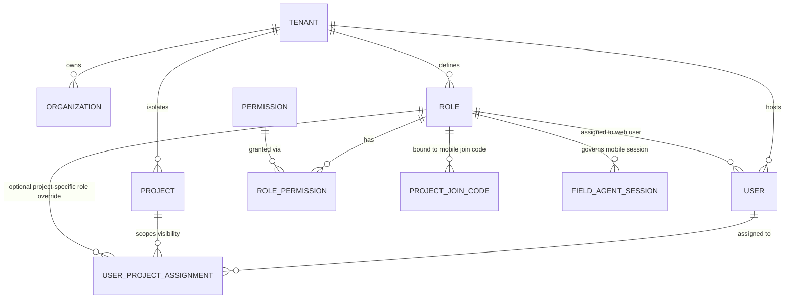

# Phase 1 Implementation Plan: Multi-Tenancy, White-Label Branding & Full Relational RBAC Migration

> **Objective:** Transform **InSite Assurance** from a fixed 3-role (`MONITOR`, `LENDER`, `CONTRACTOR`) and fixed 3-tier (`MONITOR_INSPECTOR`, `INDEPENDENT_RESIDENT`, `CONTRACTOR_ENGINEER`) application into a multi-tenant SaaS platform with a **Platform Super Admin** tier, **Tenant Super Admin** tier, normalized relational **`Role`**, **`Permission`**, and **`RolePermission`** tables, configurable role names, project-scoped visibility (`UserProjectAssignment`), and tenant-level white-label branding—with **zero legacy enum technical debt**.

---

## 0. Post-Implementation Review (2026-11-18)

**Status: implemented, with carry-overs.** The checklist below is kept as the historical record. A full codebase review found that some ticked items are only partly true. Each gap is now tracked in a later phase; nothing further should be done under Phase 1.

| Checklist item | What the review found | Now tracked in |
| :--- | :--- | :--- |
| 2.3, 7.2, 7.3 (apply schema, seed, functional RBAC checks) | Still open. The only Prisma migration is the pre-Phase-1 schema, so a deploy would fail. | Phase 2, Step 0 |
| TD-1 (session revocation) | Endpoints and UI exist, but no request path reads `FieldAgentSession.isActive`, so a revoked device keeps access. | Phase 2, Step 1 |
| TD-4 (tenant and project scoping) | True for projects, BOQ, audit and reconciliation URLs. Not applied to workday reports, morning briefs, telemetry, WBS chat, mobile notifications or evidence presign. Reconciliation services also trust IDs in the request body. | Phase 2, Steps 2 and 3 |
| TD-6 (redundant banners) | Banners removed, but pages and mutation hooks both toast. | Phase 3 |
| TD-8 (settings forms) | Only the test script was added. Password, notification and 2FA forms still report success without saving. | Phase 2, Step 9 |
| 4.2 (role audit events) | Not implemented. `AuditLog` requires a `projectId`, so tenant-level events cannot be written. | Phase 2, Step 6 |
| 4.2 (role CRUD) | Roles can be edited into a tenant lock-out; `users:invite_manage` can self-escalate; duplicate-code check runs before normalisation. | Phase 2, Step 6 |
| 3.2 (default roles) | Seed and `createTenantWithDefaults` define default roles separately and disagree (new tenants get no Clerk of Works role, and Tenant Super Admin gets every permission, contrary to the catalog below). | Phase 2, Step 6 and Phase 3 |
| 5.1 (branding) | Three CSS variables are applied. KPMG logo, page title, mobile bundle and many literal colour classes ignore branding. Tenant currency and timezone are stored but never used. | Phase 6, Step 7 |
| 5.2 (permission-driven views) | View permissions (`boq:view`, `ipc:view`, `reports:view_all`, `presence:view_telemetry`) are never checked in web. | Phase 2, Step 9 |
| 6.2 (mobile role display) | Header shows the user-typed title; permissions and assurance weight are stored but never read; the app forces assurance for any contractor persona regardless of the role flag. | Phase 5 |
| Public `/auth/register` | Accepts any tenant slug and role code, so anyone can self-register as a tenant super admin. | Phase 2, Step 1 |

The six tests in `server/src/tests/rbac.phase1.test.ts` cover pure functions only. Route-level tests are added in Phase 2.

---

## 1. Relational Schema & Architectural Blueprint

### 1.1 Canonical Permission Catalog (Seeded into `permissions` Table)

| Category | Permission Key | Display Name | Surface | Default Roles Granted |
| :--- | :--- | :--- | :--- | :--- |
| `TENANT_ADMIN` | `tenant:manage_branding` | Manage Tenant White-Label Branding | `WEB` | Tenant Super Admin |
| `TENANT_ADMIN` | `roles:create_edit` | Create & Customize Roles & Permissions | `WEB` | Tenant Super Admin |
| `TENANT_ADMIN` | `users:invite_manage` | Invite Users & Assign Project Access | `WEB` | Tenant Super Admin |
| `TENANT_ADMIN` | `templates:manage_workflows` | Configure Project Workflow Templates | `WEB` | Tenant Super Admin |
| `PORTFOLIO_PROJECTS` | `projects:view_assigned` | View Assigned Projects | `WEB` | All Web Roles |
| `PORTFOLIO_PROJECTS` | `projects:view_all_tenant` | View All Projects Across Tenant | `WEB` | Tenant Super Admin, Independent Monitor, Lender |
| `PORTFOLIO_PROJECTS` | `projects:view_executive_matrix` | Access Cross-Facility Executive Risk Matrix | `WEB` | Tenant Super Admin, Independent Monitor, Lender |
| `PORTFOLIO_PROJECTS` | `projects:create` | Create & Initialize New Projects | `WEB` | Tenant Super Admin, Independent Monitor |
| `PORTFOLIO_PROJECTS` | `projects:edit_baseline` | Edit Project Baseline, Geofence & Cadence | `WEB` | Tenant Super Admin, Independent Monitor |
| `PORTFOLIO_PROJECTS` | `projects:manage_standards_docs` | Manage Project Standards & Needs Assessments | `WEB` | Tenant Super Admin, Independent Monitor |
| `BOQ_SCHEDULE` | `boq:view` | View Bill of Quantities (BOQ) & WBS | `BOTH` | All Roles |
| `BOQ_SCHEDULE` | `boq:upload_edit` | Upload BOQ & Edit WBS Mappings | `WEB` | Tenant Super Admin, Independent Monitor |
| `BOQ_SCHEDULE` | `boq:configure_hold_points` | Configure Mandatory Visual Hold-Points | `WEB` | Tenant Super Admin, Independent Monitor |
| `BOQ_SCHEDULE` | `contractors:manage_packages` | Manage Contractors & Trade Work Packages | `WEB` | Tenant Super Admin, Independent Monitor |
| `BOQ_SCHEDULE` | `schedule:view_variance` | View Project Schedule Analysis & Variance | `WEB` | Tenant Super Admin, Independent Monitor, Lender |
| `BOQ_SCHEDULE` | `schedule:catch_up_refactor` | Refactor Schedule ("Catch Project Up") | `WEB` | Tenant Super Admin, Independent Monitor |
| `BOQ_SCHEDULE` | `schedule:approve_refactor` | Approve Schedule Refactoring Changes | `WEB` | Tenant Super Admin, Lender |
| `MOBILIZATION_ASSURANCE` | `mobilization:manage_roster` | Pre-Register Field Personnel & Mobilization Dates | `WEB` | Tenant Super Admin, Independent Monitor |
| `MOBILIZATION_ASSURANCE` | `mobilization:configure_reminders` | Configure Onboarding & Check-In Reminders | `WEB` | Tenant Super Admin, Independent Monitor |
| `MOBILIZATION_ASSURANCE` | `assurance:review_credentials` | Approve/Reject Contractor Identity & Liveness | `WEB` | Tenant Super Admin, Independent Monitor, Lender |
| `MOBILIZATION_ASSURANCE` | `sessions:revoke_device` | Revoke or Restore Mobile Device Sessions | `WEB` | Tenant Super Admin, Independent Monitor |
| `FIELD_PRESENCE` | `field:join_project` | Join Project via Mobile Join Code | `MOBILE` | All Mobile Field Roles |
| `FIELD_PRESENCE` | `field:submit_report` | Capture Field Evidence & Submit Reports | `MOBILE` | All Mobile Field Roles |
| `FIELD_PRESENCE` | `field:manual_checkin` | Perform On-Site GPS Check-In | `MOBILE` | All Mobile Field Roles |
| `FIELD_PRESENCE` | `field:raise_incident` | Submit Special Incident / Whistleblower Alert | `MOBILE` | All Mobile Field Roles |
| `FIELD_PRESENCE` | `presence:view_telemetry` | View Site Presence Geotags & Hourly Telemetry | `WEB` | Tenant Super Admin, Independent Monitor, Lender |
| `FIELD_PRESENCE` | `presence:manage_noshow_alerts` | Manage & Resolve No-Show Check-In Alerts | `WEB` | Tenant Super Admin, Independent Monitor |
| `REPORT_APPROVALS` | `reports:view_all` | View Field Workday/Period Reports | `WEB` | All Web Roles |
| `REPORT_APPROVALS` | `reports:raise_query` | Raise Verification Queries on Field Reports | `WEB` | Tenant Super Admin, Independent Monitor |
| `REPORT_APPROVALS` | `reports:respond_query` | Respond to Queries & Resubmit Clarified Reports | `BOTH` | Main Contractor, Contractor Engineer |
| `REPORT_APPROVALS` | `reports:approve_completion` | Approve Field Reports as Completed | `WEB` | Tenant Super Admin, Independent Monitor |
| `FINANCIAL_IPC` | `ipc:view` | View IPC Drawdown Claims & Reconciliation Queue | `WEB` | All Web Roles |
| `FINANCIAL_IPC` | `ipc:submit_claim` | Submit Contractor IPC Drawdown Claims | `WEB` | Main Contractor, Independent Monitor |
| `FINANCIAL_IPC` | `ipc:trigger_ai_reconcile` | Run AI Evidence-to-Claim Reconciliation | `WEB` | Tenant Super Admin, Independent Monitor |
| `FINANCIAL_IPC` | `ipc:certify_valuation` | Certify Valuation Report & Recommend Tranche Release | `WEB` | Independent Monitor |
| `FINANCIAL_IPC` | `tranche:approve_disbursement` | Record Final Tranche / Milestone Disbursement Decision | `WEB` | Lender |
| `FINANCIAL_IPC` | `milestone:verify_direct_release` | Verify Direct Milestone Completion (IPC-Optional Mode) | `WEB` | Tenant Super Admin, Independent Monitor |
| `FINANCIAL_IPC` | `valuation:export_pdf` | Export Disbursement Valuation Report PDF | `WEB` | Tenant Super Admin, Independent Monitor, Lender |
| `AUDIT_CLOSEOUT` | `audit:view_ledger` | Inspect Cryptographic SHA-256 Audit Ledger | `WEB` | Tenant Super Admin, Independent Monitor, Lender |
| `AUDIT_CLOSEOUT` | `handover:manage_links` | Generate External Stakeholder Handover Links | `WEB` | Tenant Super Admin, Independent Monitor |
| `AUDIT_CLOSEOUT` | `handover:review_feedback` | Review Stakeholder Handover Reports & Media | `WEB` | Tenant Super Admin, Independent Monitor, Lender |
| `AUDIT_CLOSEOUT` | `retention:manage_defects` | Log & Verify Retention Period Defect Tickets | `BOTH` | Tenant Super Admin, Independent Monitor, Main Contractor |
| `AUDIT_CLOSEOUT` | `retention:release_escrow` | Approve Final Retention Escrow Release | `WEB` | Tenant Super Admin, Lender |

---

## 2. Audited Technical Debt, Broken Flows & Redundant Code (To Fix in Phase 1)

During the Phase 1 codebase audit, the following bugs, broken flows, security gaps, and redundant patterns were identified and added to our Phase 1 resolution checklist:

| # | Area & Files | Issue Flagged | Phase 1 Resolution |
| :--- | :--- | :--- | :--- |
| **TD-1** | **Mocked Field Agent Roster & Revocation** ([SettingsPage.tsx](file:///c:/Users/tochi/Documents/Development%20Work/KPMG/inSite%20Assurance/web/src/pages/settings/SettingsPage.tsx)) | `SettingsPage` renders a hardcoded `INITIAL_FIELD_AGENTS` array (`agent-1..3`) and mutates React state locally—device revocations do not persist or invalidate real `FieldAgentSession` rows in PostgreSQL. | Add real `GET /api/v1/projects/:projectId/field-sessions` and `PATCH /api/v1/projects/:projectId/field-sessions/:sessionId/status` endpoints (plus `auditLog` recording) and wire `SettingsPage` to live database sessions. |
| **TD-2** | **Broken Audit Ledger Role Filters** ([AuditLedgerPage.tsx](file:///c:/Users/tochi/Documents/Development%20Work/KPMG/inSite%20Assurance/web/src/pages/audit/AuditLedgerPage.tsx)) | Role filter pills check `entry.actorType.includes("MONITOR" | "CONTRACTOR" | "LENDER")`, even though `actorType` is `'WEB_USER' | 'FIELD_AGENT' | 'AI_SYSTEM'`. Selecting any role filter returns empty or incorrect rows. | Filter by `actorDisplayName` / dynamic role tags (`entry.actorDisplayName` or `actorType`) and replace static role filter assumptions with dynamic actor/system filters. |
| **TD-3** | **React Rules of Hooks Violation & NaN% Division** ([PortfolioExecutivePage.tsx](file:///c:/Users/tochi/Documents/Development%20Work/KPMG/inSite%20Assurance/web/src/pages/dashboard/PortfolioExecutivePage.tsx)) | `portfolioColumns = useMemo(...)` is called *after* early `if (isLoading)` and `if (!summary)` returns, violating React's Rules of Hooks. Additionally, dividing by `summary.activeProjectsCount` when 0 yields `NaN%`, and `<a href="/app/settings">` triggers a full browser reload instead of SPA routing. | Move `useMemo` above early returns, guard `activeProjectsCount === 0`, and replace `<a href>` with `<Link to="/app/settings">`. |
| **TD-4** | **Unscoped Tenant / Project Access & Cross-Project IDOR** ([projects.service.ts](file:///c:/Users/tochi/Documents/Development%20Work/KPMG/inSite%20Assurance/server/src/modules/projects/projects.service.ts), [incident.service.ts](file:///c:/Users/tochi/Documents/Development%20Work/KPMG/inSite%20Assurance/server/src/modules/incidents/incident.service.ts)) | `listProjectsForUser`, `getPortfolioExecutiveSummary`, and `listContractorVerifications('all')` return every project globally without tenant or user assignment scoping. `resolveIncidentReport` updates by `id` alone without checking `projectId`, validating `status`, or writing an `AuditLog`. | Enforce `tenantId` and `UserProjectAssignment` scoping across all project/portfolio/verification queries; scope `resolveIncidentReport` by `{ id, projectId }`, validate `status` with `IncidentStatusEnum`, and emit an `AuditLog` event. |
| **TD-5** | **Hardcoded Web Notification `targetRole` Routing** ([notifications.service.ts](file:///c:/Users/tochi/Documents/Development%20Work/KPMG/inSite%20Assurance/server/src/modules/notifications/notifications.service.ts), [workdayReports.service.ts](file:///c:/Users/tochi/Documents/Development%20Work/KPMG/inSite%20Assurance/server/src/modules/workday-reports/workdayReports.service.ts)) | `WebNotification` routes alerts using `targetRole = 'MONITOR'`. Custom SaaS roles (e.g., *"M&E Lead"* or *"Tenant Super Admin"*) would never see these notifications. | Migrate `WebNotification` to `targetPermissionKey` (e.g., `'reports:view_all'`) and match against the authenticated user's permission set. |
| **TD-6** | **Redundant Local `statusMessage` Banners & Wrong Tranche Fallback** ([BoqAndHoldPointsPage.tsx](file:///c:/Users/tochi/Documents/Development%20Work/KPMG/inSite%20Assurance/web/src/pages/boq/BoqAndHoldPointsPage.tsx), [ReconciliationWorkbenchPage.tsx](file:///c:/Users/tochi/Documents/Development%20Work/KPMG/inSite%20Assurance/web/src/pages/reconciliation/ReconciliationWorkbenchPage.tsx)) | Pages maintain redundant `statusMessage` banners duplicating `sonner` toasts already fired in mutation hooks. Also, `BoqAndHoldPointsPage` shows `"Tranche #1"` even when `item.tranche` is `null` (unmapped). | Remove redundant `statusMessage` state where mutation hooks already emit `sonner` toasts, and display `"Unmapped"` when `item.tranche` is `null`. |
| **TD-7** | **Duplicated User Serialization & Mobile Hardcoded Fallbacks** ([auth.routes.ts](file:///c:/Users/tochi/Documents/Development%20Work/KPMG/inSite%20Assurance/server/src/modules/auth/auth.routes.ts), [ProfileContext.tsx](file:///c:/Users/tochi/Documents/Development%20Work/KPMG/inSite%20Assurance/mobile/src/context/ProfileContext.tsx), [ProfileAndProjectsScreen.tsx](file:///c:/Users/tochi/Documents/Development%20Work/KPMG/inSite%20Assurance/mobile/src/screens/ProfileAndProjectsScreen.tsx)) | `/auth/me` manually duplicates user serialization from `auth.service.ts`. Mobile `ProfileContext` falls back to fake `'proj-lkk-402'` instead of empty/null, and `ProfileAndProjectsScreen`'s `onApplyPersona` mutates local state without issuing a real server session/token. | Extract shared `serializeWebUserProfile` in `auth.service.ts`; clean up fake fallback IDs in `ProfileContext.tsx`; and make mobile role/persona metadata driven by real backend role payloads. |
| **TD-8** | **Demonstrative-Only Settings Forms & Zero Automated Verification** ([SettingsPage.tsx](file:///c:/Users/tochi/Documents/Development%20Work/KPMG/inSite%20Assurance/web/src/pages/settings/SettingsPage.tsx)) | Notification preferences and password forms in `SettingsPage` are local `setTimeout` stubs, and the repo has no automated verification tests. | Persist user/tenant notification & branding settings where applicable in Phase 1, clearly separate future-phase SSO/2FA placeholders, and add a Phase 1 backend RBAC & tenant isolation verification script. |

---

## 3. Step-by-Step Implementation Checklist

### Step 0: Technical Debt & Broken Flow Fixes (Integrated with Phase 1)
- [x] **TD-1**: Add `GET /api/v1/projects/:projectId/field-sessions` and `PATCH /api/v1/projects/:projectId/field-sessions/:sessionId/status` (with `sessions:revoke_device` permission + `AuditLog`), and replace `INITIAL_FIELD_AGENTS` in `SettingsPage.tsx` with real API queries/mutations.
- [x] **TD-2**: Fix broken role filters in `AuditLedgerPage.tsx` to match dynamic actor/role labels rather than `actorType.includes('MONITOR')`.
- [x] **TD-3**: Fix `PortfolioExecutivePage.tsx` React Hook ordering (`useMemo` above early returns), `activeProjectsCount === 0` divide-by-zero guard, and replace `<a href="/app/settings">` with `<Link>`.
- [x] **TD-4**: Enforce tenant & project assignment scoping across `projects.service.ts` (`listProjectsForUser`, `getPortfolioExecutiveSummary`, `listContractorVerifications`, `getProjectBaselineDetails`), and fix `incident.routes.ts` / `incident.service.ts` (`projectId` scoping, Zod status validation, `AuditLog`).
- [x] **TD-5**: Replace `WebNotification.targetRole` with `targetPermissionKey` in Prisma, `shared`, `notifications.service.ts`, and `workdayReports.service.ts`.
- [x] **TD-6**: Remove redundant `statusMessage` banners in `BoqAndHoldPointsPage.tsx` and `ReconciliationWorkbenchPage.tsx` (relying on `sonner` toasts) and show `"Unmapped"` for unmapped BOQ items instead of `"Tranche #1"`.
- [x] **TD-7**: Consolidate `serializeWebUserProfile` across `auth.service.ts` and `auth.routes.ts` (`/me`), and remove fake `'proj-lkk-402'` fallback in mobile `ProfileContext.tsx`.
- [x] **TD-8**: Add an automated Phase 1 backend RBAC & multi-tenancy verification test script in `server/`.

### Step 1: Shared Package Refactoring (`@insite/shared`)
- [x] **1.1 Update `shared/src/enums.ts`**:
  - [x] Remove hardcoded `UserRoleEnum` (`MONITOR`, `LENDER`, `CONTRACTOR`) and `IndependenceTierEnum` (`MONITOR_INSPECTOR`, `INDEPENDENT_RESIDENT`, `CONTRACTOR_ENGINEER`) as static access-control enums.
  - [x] Add `RoleSurfaceEnum = z.enum(['WEB', 'MOBILE', 'BOTH'])`.
  - [x] Add `FieldPersonaTypeEnum = z.enum(['INDEPENDENT_VERIFIER', 'CONTRACTOR_EXECUTOR', 'NONE'])` (distinguishes M&E/Monitors from Contractors for mobile workflows and AI briefs).
  - [x] Add `OrganizationCategoryEnum = z.enum(['ADVISORY_MONITOR', 'FINANCIER_LENDER', 'CONTRACTOR', 'CLIENT_OWNER', 'GOVERNMENT_MDA', 'OTHER'])`.
  - [x] Add `PermissionCategoryEnum` (`TENANT_ADMIN`, `PORTFOLIO_PROJECTS`, `BOQ_SCHEDULE`, `MOBILIZATION_ASSURANCE`, `FIELD_PRESENCE`, `REPORT_APPROVALS`, `FINANCIAL_IPC`, `AUDIT_CLOSEOUT`).
  - [x] Export the canonical `SYSTEM_PERMISSIONS_CATALOG` array with all permission keys, labels, descriptions, categories, and surfaces so both backend seeding and frontend role-builder UIs share a single source of truth.
  - [x] Add `AUDIT_ACTION_TYPES` for RBAC & Tenant governance: `TENANT_CREATED`, `TENANT_BRANDING_UPDATED`, `ROLE_CREATED`, `ROLE_UPDATED`, `USER_PROJECT_ASSIGNED`.
- [x] **1.2 Create `shared/src/schemas/rbac.schema.ts`**:
  - [x] `TenantBrandingConfigSchema` (`logoUrl`, `primaryColorHex`, `navyColorHex`, `pdfHeaderTitle`, `pdfFooterDisclaimer`).
  - [x] `TenantDtoSchema`, `CreateTenantRequestSchema`, `UpdateTenantBrandingRequestSchema`.
  - [x] `PermissionDtoSchema`.
  - [x] `RoleDtoSchema` (`id`, `tenantId`, `name`, `code`, `codeSuffix`, `description`, `surface`, `fieldPersonaType`, `assuranceWeight`, `requiresIdentityAssurance`, `isSystemDefault`, `permissions: z.array(PermissionDtoSchema)`).
  - [x] `CreateRoleRequestSchema` and `UpdateRoleRequestSchema` (accepting `permissionIds: z.array(z.string().uuid())` or `permissionKeys: z.array(z.string())`).
  - [x] `AssignUserProjectsRequestSchema` (`projectIds: z.array(z.string().uuid())`, optional per-project `roleId`).
- [x] **1.3 Update Existing Shared Schemas**:
  - [x] `shared/src/schemas/auth.schema.ts`: Update `WebRegisterRequestSchema`, `WebUserDtoSchema`, and `MobileSessionProfileSchema` to carry `tenantId`, `tenantName`, `isPlatformSuperAdmin`, `roleId`, `roleCode`, `roleName`, `fieldPersonaType`, `assuranceWeight`, `requiresIdentityAssurance`, and `permissions: z.array(z.string())`.
  - [x] `shared/src/schemas/project.schema.ts`: Update `ProjectJoinCodeDtoSchema` to include `roleId`, `roleCode`, `roleName`, `codeSuffix`, `fieldPersonaType`, and `assuranceWeight` instead of static `independenceTier`.
  - [x] `shared/src/schemas/evidence.schema.ts` & `reconciliation.schema.ts` & `telemetry.schema.ts` & `notification.schema.ts`: Replace `independenceTier` / `targetRole` enum constraints with dynamic role metadata (`reporterRoleId`, `reporterRoleName`, `reporterRoleBadge`, `assuranceWeight`, `targetPermissionKey`).
  - [x] Rebuild `@insite/shared` (`npm run build --workspace=@insite/shared`) and verify zero TypeScript errors.

---

### Step 2: Database Schema & Migration (`server/prisma/schema.prisma`)
- [x] **2.1 Define Multi-Tenant & Relational RBAC Models**:
  - [x] Add `Tenant` model (`id`, `name`, `slug`, `status`, `defaultCurrency`, `timezone`, `brandingConfig`, `createdAt`, `updatedAt`).
  - [x] Add `Permission` model (`id`, `key @unique`, `name`, `description`, `category`, `surface`, `createdAt`).
  - [x] Add `Role` model (`id`, `tenantId`, `name`, `code`, `codeSuffix`, `description`, `surface`, `fieldPersonaType`, `assuranceWeight`, `requiresIdentityAssurance`, `isSystemDefault`, `createdAt`, `updatedAt`, `@@unique([tenantId, code])`).
  - [x] Add `RolePermission` model (`id`, `roleId`, `permissionId`, `createdAt`, `@@unique([roleId, permissionId])`).
  - [x] Add `UserProjectAssignment` model (`id`, `userId`, `projectId`, `roleId?`, `createdAt`, `@@unique([userId, projectId])`).
- [x] **2.2 Migrate Existing Models Away from Static Enums**:
  - [x] Remove `enum UserRole` and `enum IndependenceTier` from `schema.prisma`.
  - [x] Update `Organization`: Add `tenantId` FK to `Tenant`; replace `roleType: UserRole` with `category: String @default("OTHER")`.
  - [x] Update `User`: Add `tenantId` FK to `Tenant`, `roleId` FK to `Role`, and `isPlatformSuperAdmin: Boolean @default(false)`; remove `role: UserRole`.
  - [x] Update `Project`: Add `tenantId` FK to `Tenant`.
  - [x] Update `ProjectJoinCode`: Add `roleId` FK to `Role`; remove `independenceTier: IndependenceTier`.
  - [x] Update `FieldAgentSession`: Add `roleId` FK to `Role`, `roleNameSnapshot: String`, `fieldPersonaType: String @default("INDEPENDENT_VERIFIER")`, `assuranceWeight: Float @default(1.0)`; remove `independenceTier: IndependenceTier`.
  - [x] Update `FieldEvidenceLog`: Add `reporterRoleId: String? @db.Uuid`, `reporterRoleName: String`, `assuranceWeight: Float @default(1.0)`; remove `independenceTier: IndependenceTier`.
  - [x] Update `IpcLineItem`: Replace `highestCorroboratingTier: IndependenceTier?` with `highestCorroboratingRoleName: String?` and `highestCorroboratingWeight: Float?`.
  - [x] Update `WebNotification`: Replace `targetRole: String @default("MONITOR")` with `targetPermissionKey: String @default("reports:view_all")` and optional `targetRoleId: String? @db.Uuid`.
- [ ] **2.3 Generate Prisma Client & Apply Schema Migration**:
  - [x] Run Prisma schema validation & `prisma generate` in `@insite/server`.
  - [ ] Apply database reset/push (`prisma db push --force-reset`) with explicit user confirmation.

---

### Step 3: Database Seeding (`server/src/db/seedDatabase.ts`)
- [x] **3.1 Seed Canonical Permissions (`Permission` Table)**:
  - [x] Upsert all permissions from `SYSTEM_PERMISSIONS_CATALOG`.
- [x] **3.2 Seed Default Tenant & Default Roles (`Tenant`, `Role`, `RolePermission`)**:
  - [x] Create default Tenant: `"KPMG Nigeria Infrastructure & Capital Advisory"` (`slug: "kpmg-nigeria"`, with KPMG branding config).
  - [x] Create system-seeded Web & Mobile Roles for the tenant and populate `RolePermission` rows for each:
    1. **Tenant Super Admin** (`code: "TENANT_SUPER_ADMIN"`, `surface: "WEB"`, all tenant permissions).
    2. **Independent Monitor** (`code: "MONITOR"`, `surface: "WEB"`, certifier & baseline permissions).
    3. **Lender / Guarantor** (`code: "LENDER"`, `surface: "WEB"`, portfolio map, executive matrix, tranche decision, audit ledger permissions).
    4. **Main Contractor** (`code: "CONTRACTOR"`, `surface: "WEB"`, assigned project view, BOQ view, IPC claim submission, query response).
    5. **Monitor Inspector (Visiting QS / COREN)** (`code: "MONITOR_INSPECTOR"`, `codeSuffix: "INS"`, `surface: "MOBILE"`, `fieldPersonaType: "INDEPENDENT_VERIFIER"`, `assuranceWeight: 1.0`, `requiresIdentityAssurance: false`).
    6. **Independent Resident Clerk of Works** (`code: "INDEPENDENT_RESIDENT"`, `codeSuffix: "COW"`, `surface: "MOBILE"`, `fieldPersonaType: "INDEPENDENT_VERIFIER"`, `assuranceWeight: 0.85`, `requiresIdentityAssurance: false`).
    7. **Contractor Site Engineer** (`code: "CONTRACTOR_ENGINEER"`, `codeSuffix: "CON"`, `surface: "MOBILE"`, `fieldPersonaType: "CONTRACTOR_EXECUTOR"`, `assuranceWeight: 0.4`, `requiresIdentityAssurance: true`).
- [x] **3.3 Seed Demo Users (Including Super Admin) & Project Assignments**:
  - [x] Seed `admin@insite.ng` (Platform & Tenant Super Admin, `isPlatformSuperAdmin: true`, Role: `TENANT_SUPER_ADMIN`).
  - [x] Seed `monitor@insite.ng` (Role: `MONITOR`), `lender@insite.ng` (Role: `LENDER`), and `contractor@insite.ng` (Role: `CONTRACTOR` with `UserProjectAssignment` rows for `LKK-402` and `ABJ-108`).
  - [x] Update seeded `ProjectJoinCode`, `FieldAgentSession`, `FieldEvidenceLog`, and `IpcLineItem` records in `seedDatabase.ts` to link to the relational `Role` records.

---

### Step 4: Backend Auth, Permission Middleware & RBAC Module (`@insite/server`)
- [x] **4.1 Refactor `server/src/middleware/auth.middleware.ts`**:
  - [x] Update `WebJwtPayload` to include `tenantId`, `isPlatformSuperAdmin`, `roleId`, `roleCode`, `roleName`, and `permissions: string[]`.
  - [x] Update `FieldAgentJwtPayload` to include `tenantId`, `roleId`, `roleCode`, `roleName`, `fieldPersonaType`, `assuranceWeight`, and `permissions: string[]`.
  - [x] Replace `requireRole(...allowedRoles)` with `requirePermission(...requiredPermissions: string[])` (which allows access if `req.webUser.isPlatformSuperAdmin` is true OR if `req.webUser.permissions` contains at least one of the required permissions).
  - [x] Add `requireSuperAdmin` middleware for platform/tenant administration routes.
- [x] **4.2 Create `server/src/modules/rbac/rbac.service.ts` & `rbac.routes.ts`**:
  - [x] `GET /api/v1/rbac/permissions`: Lists all system permissions grouped by category.
  - [x] `GET /api/v1/rbac/roles`: Lists all roles for the active tenant with their linked `RolePermission` -> `Permission` records and assigned user counts.
  - [x] `POST /api/v1/rbac/roles`: Creates a new custom role for the tenant and inserts rows into `RolePermission` inside a transaction; logs `ROLE_CREATED` audit event.
  - [x] `PUT /api/v1/rbac/roles/:roleId`: Updates a role's display name (`name`), description, `fieldPersonaType`, `assuranceWeight`, `requiresIdentityAssurance`, and replaces its `RolePermission` rows; logs `ROLE_UPDATED`.
  - [x] `DELETE /api/v1/rbac/roles/:roleId`: Safely deletes a custom role if no active users/sessions are bound to it.
  - [x] `GET /api/v1/rbac/users` & `POST /api/v1/rbac/users` & `PUT /api/v1/rbac/users/:userId/assignments`: Manage tenant users, assign their `roleId`, and configure their `UserProjectAssignment` project access list.
  - [x] `GET /api/v1/rbac/tenant` & `PUT /api/v1/rbac/tenant/branding`: Fetch and update tenant white-label branding (`Tenant.brandingConfig`); Platform Super Admin can also list/create tenants (`POST /api/v1/rbac/tenants`).
- [x] **4.3 Refactor Existing Backend Services & Routes**:
  - [x] `server/src/modules/auth/auth.service.ts`: Query `User` with `role: { include: { rolePermissions: { include: { permission: true } } } }` and `tenant: true`; sign JWT with resolved permission keys; update `joinProjectMobile` and `demoSkipVerificationMobile` to resolve mobile role from `joinCodeRecord.role` and check `role.requiresIdentityAssurance`.
  - [x] `server/src/modules/projects/projects.routes.ts` & `projects.service.ts`:
    - [x] Replace `requireRole('MONITOR')` with `requirePermission('projects:create')` / `requirePermission('projects:edit_baseline')`.
    - [x] Replace `requireRole('MONITOR', 'LENDER')` on contractor verification review with `requirePermission('assurance:review_credentials')`.
    - [x] In `listProjectsForUser`, scope by `tenantId: webUser.tenantId` (or optional tenant filter if `isPlatformSuperAdmin`), and if user lacks `projects:view_all_tenant`, filter `where: { userAssignments: { some: { userId: webUser.userId } } }`.
    - [x] When creating a project, generate join codes from the tenant's active mobile roles (`surface: 'MOBILE' | 'BOTH'`).
    - [x] Filter `visibleJoinCodes` based on permissions: users without `projects:edit_baseline` or `mobilization:manage_roster` only see join codes matching their persona (`CONTRACTOR_EXECUTOR`).
  - [x] `server/src/modules/boq/boq.routes.ts` & `boq.service.ts`: Replace `requireRole('MONITOR')` with `requirePermission('boq:upload_edit')` / `requirePermission('boq:configure_hold_points')`.
  - [x] `server/src/modules/reconciliation/reconciliation.routes.ts` & `reconciliation.service.ts`:
    - [x] Replace `requireRole(...)` with `requirePermission('ipc:submit_claim')`, `requirePermission('ipc:trigger_ai_reconcile')`, `requirePermission('reports:raise_query')`, `requirePermission('reports:respond_query')`, `requirePermission('ipc:certify_valuation')`, `requirePermission('tranche:approve_disbursement')`, `requirePermission('valuation:export_pdf')`.
    - [x] Update corroboration evaluation in `reconcileIpcLineItems` (`azure-openai.service.ts`) to use `assuranceWeight` and `fieldPersonaType` (`INDEPENDENT_VERIFIER` vs. `CONTRACTOR_EXECUTOR`) instead of hardcoded `IndependenceTier`.
  - [x] `server/src/modules/audit/audit.routes.ts`, `incidents/incident.routes.ts`, `wbs-chat/wbsChat.routes.ts`, `notifications/notifications.service.ts`: Replace static role checks with permission checks.
  - [x] `server/src/integrations/pdf-report.service.ts`: Read the project's `Tenant.brandingConfig` (`pdfHeaderTitle`, `pdfFooterDisclaimer`, `primaryColorHex`) when generating the Valuation Report PDF.

---

### Step 5: Web Portal RBAC, Role Builder UI & Dynamic Branding (`@insite/web`)
- [x] **5.1 Update Auth Context & API Types (`web/src/lib/auth-context.tsx`, `web/src/api/types.ts`)**:
  - [x] Expose `user.roleName`, `user.roleCode`, `user.permissions`, `user.isPlatformSuperAdmin`, `user.tenant`, `hasPermission(permissionKey)`, and `hasAnyPermission(...permissionKeys)` in `useAuth()`.
  - [x] Add `admin@insite.ng` (Super Admin) to `SEEDED_DEMO_ACCOUNTS` in `auth-context.tsx` and `LoginPage.tsx` so demo switchers include the Super Admin role alongside Independent Monitor, Lender, and Main Contractor.
  - [x] Apply `user.tenant.brandingConfig` dynamically to CSS custom properties (`--color-brand-primary`, `--color-brand-navy`) on login/load.
- [x] **5.2 Refactor Navigation & Views to Permission Checks**:
  - [x] `web/src/App.tsx`: Replace `user.role === 'MONITOR'` and `user.role !== 'CONTRACTOR'` with `hasPermission('projects:create')`, `hasPermission('valuation:export_pdf')`, `hasPermission('audit:view_ledger')`, and `hasPermission('projects:view_executive_matrix')`.
  - [x] `web/src/components/AppShell.tsx`:
    - [x] Display dynamic `user.roleName` (e.g., *"Independent Monitor"*, *"Tenant Super Admin"*, or any custom client-configured role name) instead of ternary `user?.role === 'MONITOR' ? ...`.
    - [x] Render tenant logo and name from `user.tenant.brandingConfig` in the sidebar header.
    - [x] Gate sidebar links (`Executive Risk Matrix`, `Audit Ledger`, `Role & Tenant Admin`) via `hasPermission(...)`.
  - [x] Refactor all page/component role checks (`BoqAndHoldPointsPage.tsx`, `PortfolioDashboardPage.tsx`, `ProjectsDirectoryPage.tsx`, `ReconciliationWorkbenchPage.tsx`, `SitePresencePanel.tsx`, `ContractorVerificationQueue.tsx`, `EvidenceBadge.tsx`, `EvidenceOverlayDrawer.tsx`, `LiveGeospatialMap.tsx`) to use `hasPermission(...)` and dynamic `reporterRoleName` / `assuranceWeight`.
- [x] **5.3 Build Super Admin Role, Permission & Tenant Branding Console (`web/src/pages/settings/SettingsPage.tsx`)**:
  - [x] Add **"Roles & Permissions"** tab (visible when `hasPermission('roles:create_edit')` or `isPlatformSuperAdmin`):
    - [x] **Role Directory Table**: Lists all Web and Mobile roles with their custom display name, surface badge (`Web`, `Mobile`, `Both`), field persona type, assurance weight, granted permission count, and user count.
    - [x] **Create / Customize Role Drawer & Wizard**:
      - [x] Edit Role Display Name (satisfying configurable role names), Code, Surface (`WEB` / `MOBILE` / `BOTH`), Mobile Join Code Suffix (3 chars), Field Persona (`Independent Verifier / M&E` vs. `Contractor Executor`), Assurance Weight slider (`0.1` to `1.0`), and `Requires Identity & Liveness Verification` toggle.
      - [x] **Categorized Permission Matrix**: Accordion/cards for all 8 permission categories with individual checkboxes, "Select All in Category" toggles, and a live **"Unlocked Workspace Views Preview"** badge bar showing which pages the role will see.
  - [x] Add **"Users & Project Visibility"** section (visible when `hasPermission('users:invite_manage')`):
    - [x] Assign users to custom roles and configure whether they have tenant-wide project visibility (`projects:view_all_tenant`) or specific `UserProjectAssignment` access.
  - [x] Add **"Tenant & White-Label Branding"** tab (visible when `hasPermission('tenant:manage_branding')` or `isPlatformSuperAdmin`):
    - [x] Configure Organization/Tenant Name, Logo URL, Primary Brand Color, Sidebar Navy Color, and PDF Valuation Report Header/Footer text with instant live preview.

---

### Step 6: Mobile App Dynamic Role & Persona Adaptation (`@insite/mobile`)
- [x] **6.1 Update Mobile Profile Store & Auth Schemas (`mobile/src/storage/secureProfileStore.ts`)**:
  - [x] Store `activeRoleId`, `activeRoleCode`, `activeRoleName`, `activeFieldPersonaType` (`INDEPENDENT_VERIFIER` | `CONTRACTOR_EXECUTOR`), `activeAssuranceWeight`, `requiresIdentityAssurance`, and `permissions: string[]` in the mobile profile store.
- [x] **6.2 Refactor Mobile Screens**:
  - [x] `mobile/src/navigation/RootNavigator.tsx` & `EnterProjectCodeScreen.tsx`: Route to `AssuranceWizard` based on `profile.requiresIdentityAssurance` / `activeFieldPersonaType` and `profile.assuranceStatus === 'NOT_SUBMITTED'` rather than hardcoded `activeIndependenceTier === 'CONTRACTOR_ENGINEER'`.
  - [x] `mobile/src/screens/ProfileAndProjectsScreen.tsx` & `SettingsScreen.tsx`: Display dynamic `profile.activeRoleName` (customizable role name) and assurance weight badge instead of hardcoded tier strings.

---

### Step 7: End-to-End Verification Checklist
- [x] **7.1 TypeScript & Build Verification**:
  - [x] `@insite/shared` builds cleanly (`npm run build --workspace=@insite/shared`).
  - [x] `@insite/server` compiles cleanly (`npm run build --workspace=@insite/server`).
  - [x] `@insite/web` compiles cleanly (`npm run build --workspace=@insite/web`).
  - [x] `@insite/mobile` typechecks cleanly (`npx tsc --noEmit` in `mobile/`).
  - [x] Automated Phase 1 RBAC unit test suite (`server/src/tests/rbac.phase1.test.ts`, 6/6 tests passing).
- [ ] **7.2 Database & Seed Verification**:
  - [ ] `seedDatabase()` runs cleanly without errors and populates `Tenant`, `Permission`, `Role`, `RolePermission`, `User`, `UserProjectAssignment`, and demo projects (pending `prisma db push --force-reset` confirmation).
- [ ] **7.3 Functional RBAC & SaaS Flows**:
  - [ ] Logging in as `admin@insite.ng` (Super Admin) unlocks the **Roles & Permissions** and **Tenant Branding** management tabs.
  - [ ] Creating a new role (e.g., *"M&E Field Supervisor"*) and selecting categorized permissions persists rows in `role_permissions` and immediately reflects in the Role Directory.
  - [ ] Renaming an existing role updates its display label across the Web header, sidebar, and Mobile profile.
  - [ ] Users with `projects:view_all_tenant` see all tenant projects; users without it only see projects linked via `UserProjectAssignment`.
