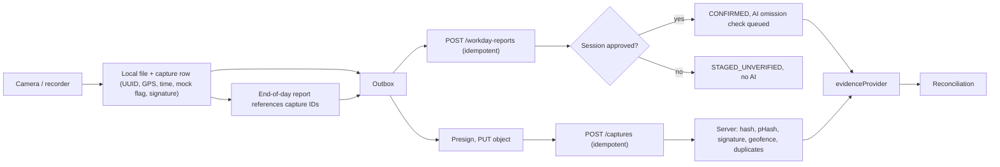

# Phase 4: Field Evidence Pipeline and Mobile Sync Reliability

| | |
| :--- | :--- |
| **Status** | Implemented; awaiting on-device testing. All steps are built. Server behaviour is covered by route tests, and mobile logic by Node tests plus an Android bundle build. The device checks are in [physical_testing_checklist.md](physical_testing_checklist.md) and will be run at the end of the programme. |
| **Depends on** | Phase 2. Phase 3 recommended first (it creates the evidence provider seam); if Phase 3 has not run, create `evidenceProvider.ts` here. |
| **Unblocks** | Phases 5, 7 |
| **Read first** | [Master plan](saas_implementation_plan.md) sections 2, 3 and 6 |

---

## 1. Overview

**Objective:** connect what field staff capture to what reconciliation reads, make offline sync lossless and idempotent, and make every integrity statement in the product true or remove it.

**In scope:** one capture-to-report pipeline on the server, real media upload, server-side integrity checks, the mobile outbox, removal of fabricated data, honest verification UI on mobile and web, build profiles.

**Out of scope:** login and multi-project on mobile (Phase 5), persona-aware briefs and report approval (Phase 7), cadence (Phase 8).

---

## 2. Context for the implementing agent

**Two pipelines exist and they do not meet**
- *Pipeline A (server only, unused by the app):* `POST /evidence/extract` then `POST /evidence/:logId/confirm` in [evidence.service.ts](../server/src/modules/evidence/evidence.service.ts). Creates `FieldEvidenceLog` and `EvidenceMedia`, runs `screenCaptureIntegrity`, Whisper and AI extraction. Reconciliation reads only these rows. Mobile has client functions for it in `mobile/src/api/evidence/evidenceApi.ts` with zero callers.
- *Pipeline B (what the app does):* photos, voice notes and text go into a per-WBS chat thread ([wbsRepository.ts](../mobile/src/storage/wbsRepository.ts), [WbsChatThreadScreen.tsx](../mobile/src/screens/WbsChatThreadScreen.tsx)); at end of day the user confirms a summary and quantity ([ConfirmAiSummarySheet.tsx](../mobile/src/screens/ConfirmAiSummarySheet.tsx)) and a `WorkdayReport` is posted ([workdayReports.service.ts](../server/src/modules/workday-reports/workdayReports.service.ts)). Nothing downstream uses it for ratings.

**Mobile defects that lose or corrupt data** (all verified in code)
- Evidence item IDs are `msg-<timestamp>-<rand>`; the server schema requires UUIDs, so any report with evidence gets a 400, which the client treats as "offline" and retries forever.
- Photos are base64 data URIs stored in SQLite and posted in chat bodies, fire-and-forget, with `is_delivered` hardcoded to 1. Voice notes are sent as local `file://` paths. Nothing is uploaded to object storage except assurance images.
- If GPS fails at the shutter, coordinates `6.4698, 3.5852` and "Ch 14+200" are attached. The thread header always shows "In-Zone · Ch 14+200"; every photo shows "GPS Verified".
- Per-photo `isMocked`, accuracy and GPS are dropped; `capturedAt` is overwritten with the report time.
- Reports are sent before they are persisted; a failed insert is only logged. The staged table lacks `project_id`, `delaysOrBlockers`, `isHoldPointClaimed`. The sync loop wraps all rows in one try/catch, so one bad row blocks the rest ([syncEngine.ts](../mobile/src/storage/syncEngine.ts)).
- Submission is not idempotent: the server ignores `localReportId`, and runs an AI call before responding while the client times out at 12 seconds.
- Contractor approval never reaches the device (nothing reads assurance status from the server), `REJECTED` is unhandled, and [BacklogReviewModal.tsx](../mobile/src/screens/BacklogReviewModal.tsx) submits staged reports without checking status.
- Assurance sync marks a row synced even when the upload failed, sending local file paths as document URLs.
- The geofence pack is held in memory only; after a restart there is no geofence check. Mobile re-implements a "not linear means radial" branch in [locationService.ts](../mobile/src/services/locationService.ts) instead of the shared `verifyPointAgainstGeofence`.
- `workdayDate` is the UTC date. "Reported today" is wrong in both directions.
- Chat messages duplicate after refetch (local `msg-` ID and server UUID both kept).
- SQLite is not encrypted. Migrations are add-column-only with errors swallowed and no version.
- Face liveness: the ML path cannot load (missing peer dependency and config), so the app always uses a three-tap fallback that returns `isLive: true`, score 0.92.
- No `eas.json`; demo flag is on in `mobile/.env`; push has no config plugin, channel or tap handler; telemetry runs only while the app is open.

**Server defects in the same area**
- `derivePhotoPerceptualHash` in [integrity.ts](../server/src/utils/integrity.ts) hashes the file hash, so it cannot detect similar images. Duplicate screening looks at the latest 500 photos across all tenants. `sha256FileHash` and `deviceSignatureHash` are client-supplied and never verified.
- `confirmEvidenceLogByAgent` has no status or assurance check; a queued log from an unapproved contractor can be confirmed, and any log can be re-confirmed with new quantities.
- [whisper.service.ts](../server/src/integrations/whisper.service.ts) returns a canned transcript ("cast 12 meters… 40 bags of Dangote cement") when no key is configured or on error. `fallbackFieldExtraction` in [azure-openai.service.ts](../server/src/integrations/azure-openai.service.ts) links evidence to the first BOQ item and asserts "verified against project geofence".
- Telemetry and workday geotag verification keep the client's `isWithinGeofence` when evaluation throws, and write one audit entry per out-of-geofence ping.
- `LOCAL_DEV_SIMULATED` storage returns URLs for routes that do not exist, so uploads cannot work without S3.

**Web text that asserts unverified facts:** `LiveGeospatialMap.tsx` ("0 Mock GPS · 0 Duplicate pHash"), `PortfolioDashboardPage.tsx` ("Device Signature: Verified"), `ContractorVerificationQueue.tsx` ("Active Head-Turn Verified"), `PortfolioExecutivePage.tsx` ("100% Hardware-Sealed Geofences").

---

## 3. Decisions

**Needs owner input**

| ID | Question | Default being built |
| :--- | :--- | :--- |
| D-4.1 | Canonical evidence pipeline | Report-centric (pipeline B's user experience) on top of per-capture records (pipeline A's data model). See section 4. |
| D-4.2 | Contractor identity check | Guided three-pose selfie plus ID photo, reviewed by a human. All "liveness verified" wording and scores are removed. The data model keeps room for a real liveness result later. |
| D-4.3 | Background telemetry | Foreground only, plus a ping at every capture and report. Wording changes from "hourly telemetry" to "presence while the app is open". |

**Made here**
- Without a configured AI or speech provider, the system records "pending" and never invents content. Simulated output exists only in demo mode and is labelled.
- A capture with no GPS fix is allowed but marked "location unavailable" and can never count as in-geofence.
- The device signs captures with a per-install key; the server verifies. This replaces the unkeyed hash.

---

## 4. Target pipeline

- A **capture** is one photo, voice note or document with its hardware metadata. It reuses `FieldEvidenceLog` + `EvidenceMedia` (rename to `EvidenceCapture` if you prefer; data is disposable).
- A **workday report** is the human-confirmed statement (summary, quantity, unit, hold-point claim, blockers) for one WBS item and period, linking the captures that support it.
- The **evidence provider** returns, per BOQ item, confirmed reports with their captures. A capture with no confirmed report does not count as evidence. Phase 7 will add "approved" as a further condition when report approval is enabled.
- The old `extract` and `confirm` endpoints are removed. Transcript and quantity suggestion become an optional assist endpoint the summary sheet can call.

---

## 5. Schema changes

**Server**
- `FieldEvidenceLog` (capture): add `workdayReportId String?`, `locationAvailable Boolean`, `signatureVerified Boolean?`, `devicePublicKeyId String?`, `serverSha256 String?`, `transcriptionStatus String @default("NOT_APPLICABLE")` (`PENDING`, `DONE`, `FAILED`, `NOT_APPLICABLE`). `isWithinGeofence` becomes nullable. Remove fields that only served the old confirm flow if unused.
- `EvidenceMedia`: `perceptualHash` computed server-side; drop `fileUrl` (object key only, from Phase 2).
- `WorkdayReport`: add `clientReportId String @unique`, `delaysOrBlockers String?`, `reporterTimezone String`, `aiCheckStatus String` (`PENDING`, `DONE`, `SKIPPED`, `FAILED`). Convert `status` to a Prisma enum. Replace `evidenceItems Json` with the capture relation (keep a small JSON for text-only notes).
- `FieldAgentSession`: add `devicePublicKey String?`, `devicePublicKeyAlg String?`.
- `SiteTelemetryPing`: add `clientPingId String @unique`.
- `WbsChatMessage`: add `clientMessageId String? @unique`, `senderSessionId`/`senderUserId`, `captureId String?`; `mediaUrls` no longer accepts data URIs or file paths.
- `IncidentReport`: add `clientIncidentId String @unique`.
- `AuditActionType`: add `CAPTURE_REGISTERED`, `CAPTURE_FLAGGED_INTEGRITY`, `TELEMETRY_ANOMALY_SUMMARY`.

**Mobile SQLite** (versioned with `PRAGMA user_version`; a destructive rebuild is acceptable in dev)
- `outbox (id, project_id, kind, payload_json, status, attempts, next_attempt_at, last_error, created_at)`.
- `captures (id, project_id, wbs_item_id, kind, local_path, object_key, lat, lon, accuracy, is_mocked, location_available, captured_at, signature, upload_status)`.
- `project_baseline (project_id, json, updated_at)` for the geofence and BOQ pack.
- Reports, chat messages and incidents get `project_id` and client UUIDs; drop base64 columns.

---

## 6. Implementation checklist

**Progress, 2026-11-19 (session 1).** Items are ticked only when verified. "Built" means the code is in place, typechecks, the Android bundle builds (`npx expo export --platform android`) and the pure logic is unit-tested in Node, but it has not been run on a device. A development build is needed for that, because SQLCipher does not run in Expo Go.

| Step | State |
| :--- | :--- |
| 1 Server | Done and tested (25 route tests in `routes.phase4.test.ts`). Device-key and push items: server side done; device side pending. |
| 2 Mobile storage and outbox | Built: `storage/db` (SQLCipher key in SecureStore, `cipher_version` check, `user_version` migrations, destructive v1 rebuild), one outbox (`storage/outbox`), captures on disk with SHA-256 and Ed25519 signature, persist-then-enqueue in one transaction, sync status screen (the former backlog modal) with dead-letter Retry. `syncEngine.ts`, `telemetryRepository.ts`, `sqliteDatabase.ts`, `incidentService.ts` and all in-memory fallbacks deleted. Signing library: `@noble/ed25519` v3 + `@noble/hashes`, random bytes from `expo-crypto`. |
| 3 Capture correctness | Mostly built with Step 2: no hardcoded coordinates or chainage in mobile; per-capture fix kept; GPS constants with timeout; baseline pack persisted, shared `verifyPointAgainstGeofence` only; computed badges only; "reported today" from reports; hold-point text from `holdPointInstruction`, off by default, hold-point items only; chat merged by `clientMessageId` with ISO times; briefs upserted with their date. **Deviation:** `workdayDate` uses the reporter's device time zone, not a project zone (projects have none; see section 8). |
| 4 Assurance flow | Built (session 2). Status comes from `/auth/me` at startup, on foreground, on pull-to-refresh and on push (`useAssuranceStatusSync`). `REJECTED` shows the reason and routes to the wizard, and the session stays signed in. Backlog modal is read-only. Identity uploads use `IDENTITY_*` media types. D-4.2: the vision-camera path and its three packages are deleted, `GuidedSelfieCapture` replaces it, and the request sends `selfieSet` (capture times only). The server records no liveness result (tested); the web queue shows all three poses for manual review. Routing is role-driven only. |
| 5 Web honesty | Done (session 3 finished the login and public pages: sample positions are labelled as examples, and integrity claims now describe what the product actually does). Earlier: map, dashboard, presence panel, evidence drawer, verification queue, executive page, settings and role settings. Evidence views show photo thumbnails and voice playback (`components/evidence/CaptureMedia.tsx`) and report badges. The demo persona switcher on the mobile profile screen was removed: it set assurance status on the device, which the server now owns. |
| 6 Build, push, telemetry | Built (session 2). `eas.json` has development, preview, demo and production profiles; the demo flag is on only in `demo`. **API hosts are placeholders (`SET-…-API-HOST.invalid`) until confirmed.** `app.config.ts` reads `EAS_PROJECT_ID`, `APP_VARIANT` and the demo flag. Push: `expo-notifications` plugin with the `default` Android channel; permission is asked in context (after join, after identity submission), never at launch. Taps route by `actionType`, and a push refreshes assurance status. The real app version is registered. Unused packages are removed, `expo-dev-client` is added, the duplicate `registerRootComponent` is removed, and a `start` script exists. `expo config` resolves the plugins, with no background-location permission. |
| Carry-overs | Done (session 3). Monitors resolve workday-report queries (`POST /projects/:projectId/report-queries/:queryId/resolve`, web "Mark resolved" / "Withdraw query"; the reporter is notified, and no revision is possible afterwards). Mobile notification read state is per field session (`MobileNotificationRead`). Both are tested. |
| 7 Tests | Server done. Mobile Node tests: 16 (`npm --workspace=@insite/mobile test`). End-to-end device script not written. |

### Step 1: Server capture and report pipeline
- [x] Local dev storage: implement upload and file handlers for `LOCAL_DEV_SIMULATED` (disk under a git-ignored folder, same auth as the media endpoint) so the full flow works without S3.
- [x] `POST /projects/:projectId/captures`: idempotent on `clientCaptureId` (return the existing row). Verifies the object exists, computes `serverSha256`, verifies the device signature, evaluates the geofence with `verifyPointAgainstGeofence`, runs integrity screening, writes `CAPTURE_REGISTERED` or `CAPTURE_FLAGGED_INTEGRITY`.
- [x] Integrity screening rewrite in [integrity.ts](../server/src/utils/integrity.ts): real perceptual hash from image bytes (for example a difference hash with `sharp`); duplicate search by indexed lookup scoped to the tenant, exact on `serverSha256` and near-match on pHash within the project and across the tenant; no arbitrary 500-row window. Never trust client hashes.
- [x] Geofence: one helper used by captures, telemetry and reports. If evaluation fails or there is no fix, store `null` and add a flag. Never keep the client's claim.
- [ ] Device key: at join (and at login in Phase 5) the device registers a public key. Captures, reports and pings are signed over a canonical string; the server verifies and stores the result. Choose a pure-JS curve library that runs in React Native and Node; confirm the choice against current library docs before adopting.
  - *Server side done and tested:* Ed25519, verified with Node's built-in `crypto` (no server library). Key registered at join (`devicePublicKey`) or once via `POST /auth/device-key`; canonical strings in `shared/src/utils/deviceSignature.ts`. Still open: the device signing library (Step 2).
- [x] `POST /workday-reports`: idempotent on `clientReportId`; links captures (all must belong to the session's project and reporter); assurance gate enforced server-side (`STAGED_UNVERIFIED` when the session is not approved, and no AI call); AI omission check moves out of the request path (set `aiCheckStatus = PENDING`, process after responding, then raise the query if needed).
- [x] Staged reports are released by the server when a session is approved (in `reviewContractorVerification`), not by the client.
- [x] Revalidation: same idempotency and ownership rules; closes the targeted query.
- [x] Remove the `extract` and `confirm` routes and their shared schemas. Add `POST /workday-reports/suggest` (optional assist: transcript plus quantity suggestion for the summary sheet).
- [x] Implement `evidenceProvider.ts` per section 4 (replace the Phase 3 placeholder body). Add a test that a confirmed mobile-style report with captures changes a reconciliation rating.
- [x] Speech and AI honesty: with no provider or on failure, return `transcriptionStatus = PENDING/FAILED` and no text. Canned transcripts and the first-BOQ-item fallback only under `DEMO_MODE`, labelled "simulated". Remove "verified against project geofence" from fallback text.
- [x] Telemetry: idempotent on `clientPingId`; `createMany`; accept batches larger than 100 by chunking; replace per-ping audit entries with one `TELEMETRY_ANOMALY_SUMMARY` per session per day per anomaly type.
- [x] Chat: idempotent on `clientMessageId`; media by `captureId`; reject data URIs and `file://`.
- [x] Incidents: idempotent on `clientIncidentId`.
- [ ] `/auth/me` for field sessions is the source of truth for assurance status; add a mobile notification and push on approval and rejection (exists for the notification; confirm push).
  - *Server side done:* `/auth/me` returns status, reason and `devicePublicKeyId`; a rejected session now stays signed in (tested). Push was never sent by the server; `integrations/push.service.ts` now sends through Expo after approval/rejection. Not verified end to end (tests run with `PUSH_PROVIDER=none`; needs the Step 6 mobile config).

### Step 2: Mobile storage and outbox
- [ ] Enable SQLCipher for `expo-sqlite` with a key held in SecureStore (check the current Expo docs for the config-plugin option and key pragma). Remove "encrypted" wording anywhere it is not true until this lands.
- [ ] Versioned migrations; rebuild tables per section 5.
- [ ] One outbox processor: per-row try/catch, exponential backoff, a dead-letter state after N attempts with the error kept, ordering only where needed (a report waits for its captures). Auth failures pause the outbox (Phase 2 session-ended state) instead of counting as attempts.
- [ ] All IDs from `expo-crypto` `randomUUID()`.
- [ ] Persist first, then enqueue, then attempt send. A report the user confirmed must survive an app kill at any point.
- [ ] Media: write files to app storage, never base64 in SQLite or request bodies; upload through presign; delete the local file after the capture is registered and a retention window passes.
- [ ] Remove `syncEngine.ts` ad hoc loops, the three copies of the report payload builder, and the memory-only fallbacks that diverge from SQLite. If SQLite is unavailable, block capture with a clear message.
- [ ] Sync status surface: pending count, last error, dead-letter list with retry. Replace "Saved Offline" and "Incident Transmitted" toasts with the real state.

### Step 3: Mobile capture correctness
- [ ] Remove every hardcoded coordinate and chainage. No fix means `location_available = false` and a visible "Location unavailable" tag.
- [ ] Keep per-capture GPS, accuracy, mock flag and capture time through to the server.
- [ ] GPS acquisition: timeout, maximum age and accuracy thresholds as constants; show the accuracy.
- [ ] Persist the baseline pack and use the shared `verifyPointAgainstGeofence`. Delete the local branch in `locationService.ts`.
- [ ] Badges show only computed states: in geofence, outside, unknown, mock location flagged, pending upload, uploaded.
- [ ] `workdayDate` computed in the project timezone using `shared/src/utils/time.ts` (extend it to take an IANA zone).
- [ ] "Reported today" derived from reports for the current period, local plus server, not from a sticky flag or certified percentage.
- [ ] Hold-point certification text comes from the BOQ item's `holdPointInstruction`; the claim checkbox defaults to off and is shown only for hold-point items.
- [ ] Chat: merge by `clientMessageId`; real timestamps stored as ISO strings and formatted at render; own messages identified by sender session, not by `senderRole === "ENGINEER"`.
- [ ] Morning brief sync (formerly TD-P2-5): upsert briefs on sync, including in any remaining memory layer; show the brief date.

### Step 4: Mobile assurance flow
- [ ] Refresh assurance status from `/auth/me` on app foreground, on push, and on pull-to-refresh. Handle `REJECTED` with the reason and a route back to the wizard.
- [ ] Backlog modal: remove the static "Account Verified" pill and client-side release; it becomes a read-only view of staged reports that the server will release.
- [ ] Assurance upload: a row is synced only when every upload succeeded and the server accepted the keys. Use a dedicated media type for ID and selfie, not `SITE_PHOTO`.
- [ ] D-4.2: delete the dead vision-camera path and its three dependencies. Rename the component and copy to "guided selfie capture". Stop sending `isLive`, yaw and eye-probability values; send the three images and capture times. Server: stop setting `livenessScore`; `livenessPassed` stays false unless a real check exists. Web queue: remove "Active Head-Turn Verified"; label as "Selfie set (3 poses) for manual review".
- [x] Role-driven assurance only: use `requiresIdentityAssurance` from the server, never the persona.

### Step 5: Web honesty pass
- [ ] Replace hardcoded integrity text with values computed from data, or remove it: `LiveGeospatialMap.tsx`, `PortfolioDashboardPage.tsx`, `ContractorVerificationQueue.tsx`, `PortfolioExecutivePage.tsx`.
- [ ] Evidence views show per-capture integrity results (signature verified, duplicate flags, geofence state, location unavailable).
- [ ] Zero-data states say "no data", not "100% within".

### Step 6: Build, push, telemetry
- [ ] Add `eas.json` with development, preview and production profiles; demo flag on only in a demo profile; API base URL per profile.
- [ ] Push: add the config plugin and project ID, Android channel, tap handler that routes by `actionType`; request permission in context, not on the landing screen; real app version in the token registration.
- [ ] D-4.3: keep foreground telemetry; add a ping on each capture and report; fix overlapping flush callers with a single lock; change wording in app and web.
- [x] Remove unused dependencies (`expo-image-picker`, `@react-navigation/stack`); fix the duplicate `registerRootComponent`; add the missing `start` script; align `@types/react-native` with the installed React Native. (`@types/react-native` removed: React Native ships its own types.)

### Step 7: Tests
- [x] Server: capture idempotency, signature verification pass and fail, duplicate and near-duplicate detection with real image fixtures, geofence null handling, report idempotency under a simulated client retry, assurance gate, staged release on approval, provider-unavailable returns pending.
- [x] Mobile: unit tests for the outbox processor (ordering, backoff, dead-letter, auth pause) and the report builder, run in Node with an in-memory SQLite shim or by isolating pure logic.
- [ ] End to end (manual script in this file's appendix once written): airplane-mode capture of three photos and a voice note, confirm report, kill app, relaunch, go online; one report with four captures arrives exactly once and appears in reconciliation.

---

## 7. Definition of done

- A report submitted from the app changes an evidence rating in the web workbench.
- Killing the app at any step loses nothing the user confirmed, and retries never duplicate.
- No hardcoded coordinate, chainage or "verified" string remains in mobile or web (`grep` for `6.4698`, `14+200`, `Verified` and review each hit).
- The product claims table below is filled in with the final state.

| Claim | State after Phase 4 |
| :--- | :--- |
| Live camera only | The app has no gallery picker (`expo-image-picker` removed); evidence comes from the in-app camera. It is not a cryptographic guarantee: a rooted or modified phone can feed files to the app. |
| GPS at capture | The fix at the shutter is stored with each capture; no fix is shown as "Location unavailable", never a substitute value. Every report must carry a fix (low accuracy is a badge). The server evaluates the geofence itself. |
| Mock-location flag | The operating system's mock-location flag is recorded; on the server it makes a capture fail integrity and not count as evidence. A rooted phone can hide the flag. |
| Device signature | Each install signs captures, reports and pings with an Ed25519 key kept in the OS keystore; the server verifies with the registered public key. Invalid fails integrity; unsigned is flagged. It proves which install sent the data, not that the content is genuine. |
| Duplicate / similar photo detection | The server hashes the stored bytes (SHA-256, exact copies) and computes a 64-bit difference hash (near copies, distance 6 or less) across all the tenant's projects. A near copy of the same reporter's own photo within 6 hours is treated as a burst, not reuse. |
| Encrypted local storage | Release builds encrypt the local database with SQLCipher (key in the OS keystore) and refuse to run without it. A development build without SQLCipher works unencrypted and says so on the Sync status screen. |
| Identity check | A photo ID and a guided three-pose selfie set, compared by a person on the web. No automated liveness check, and none is claimed. |

## 8. Found during implementation

_Add items here rather than expanding scope._

**Step 1 decisions and notes (2026-11-19)**
- *Rejected sessions were deactivated.* `reviewContractorVerification` set `isActive = false` on REJECT, so the device got 401 and could never show the reason. Changed: the session stays active with `REJECTED`; its reports stay staged; revoking is a separate action.
- *Revalidation no longer lets the model rewrite a confirmed report.* `reparseWorkdayChatAfterQuery` is removed. The reporter's values are stored (omitted fields keep the previous revision's); the omission check runs after the response like a submission.
- *Rules-based omission check is labelled.* Without Azure the deterministic rules check still runs and is stored with `aiCheckEngine = RULES` and no confidence score (the old fallback invented 0.62 / 0.92).
- *Near-duplicate rule.* dHash distance at most 6 within the tenant is "recycled" and critical, except a near-duplicate of the same reporter's own capture within 6 hours, which is a burst (`SIMILAR_TO_RECENT_OWN_CAPTURE`, not critical). Constants in `server/src/utils/integrity.ts`.
- *Project time zone.* Projects have no time zone field; telemetry anomaly days use the tenant time zone. Phase 6 should add a per-project zone if projects can span zones.
- *Production now refuses to start without S3* (local disk storage is development only). Confirm the Render environment has the S3 variables set before deploying.
- *New native dependency:* `sharp` (server) for perceptual hashing.

- *One report per period (owner decision, 2026-11-19).* During the period the reporter adds photos and notes to the WBS thread; at the end they submit one full report (with voice note and details) and must confirm it is their full report (`confirmedAsFinal: true`). A second report for the same reporter, WBS item and period is refused (`409 REPORT_ALREADY_SUBMITTED`). A revision is accepted only on the latest revision and only to answer an OPEN query (`409 NO_OPEN_QUERY` / `REPORT_SUPERSEDED`). Backed by partial unique indexes in migration `20261119120000_phase4_one_report_per_period` (not expressible in `schema.prisma`; keep them if a later `migrate dev` proposes dropping them). "Period" is the calendar day until Phase 8 adds reporting cadence. Mobile (Step 3) must show the "this is my full report" confirmation and hide submit once a report exists for the period.

**Step 2 decisions and notes (2026-11-19)**
- *Reporting period uses the device time zone.* Step 3 asks for the project time zone, but projects have none (tenants do, and the baseline pack does not carry it). The report stores `reporterTimezone`, so the server can re-derive later. Phase 6 should add a project zone to the baseline pack.
- *A report links everything unreported for the WBS item.* On submit, every capture and typed note in that WBS thread not yet in a report is attached, per the owner rule (evidence gathered during the period, one full report at the end).
- *Reports without a GPS fix are allowed* and marked "location unavailable", the same rule as captures. The old sheet blocked submission without a fix.
- *Revisions from another device are sent unsigned* when the original report's period is not known on this device (and the API cannot be reached to look it up), rather than with a signature the server would reject.
- *Local files are kept 14 days after the server registers them*, then deleted (`LOCAL_FILE_RETENTION_DAYS`). After that, photos are shown through the authenticated media endpoint.
- *A development build without SQLCipher opens the database unencrypted* and the sync status screen says so; a release build without SQLCipher refuses to open it. This keeps Expo Go usable for UI work without ever claiming encryption.
- *The incident photo goes through presign and is sent as an object key*; the old code sent a base64 data URI and fell back to hardcoded coordinates.

**Owner decisions, 2026-11-19 (session 2)**
- *Project time zone as a safeguard.* `Project.timezone` (default: the tenant zone) defines the reporting day. The server rejects a report whose `workdayDate` is not the date of `confirmedAt` in that zone (`WORKDAY_DATE_MISMATCH`), and one dated more than 15 minutes in the future (`CONFIRMED_AT_IN_FUTURE`). The baseline pack and `/auth/me` carry the zone; the phone computes "today" with it. The wizard field is in Phase 6.
- *Location is required on every report.* `submissionGeotag` is mandatory for submissions and revisions. Low accuracy (over `REPORT_LOW_GPS_ACCURACY_METERS` = 50 m) is a badge, not a failure. Reports store `integrityFlags` (`LOW_GPS_ACCURACY`, `GPS_ACCURACY_UNKNOWN`, `OUTSIDE_PROJECT_GEOFENCE`, `GEOFENCE_UNAVAILABLE`, `MOCK_GPS_LOCATION_DETECTED`, `UNSIGNED`, …), shown as badges on the web. Captures in the chat may still lack a fix ("Location unavailable").
- *Geofence tolerance* (configurable, default 100 m, "within tolerance" counted as valid and noted) is specified in the Phase 6 plan, Step 3, alongside the geofence modes.
- *Photo retention:* the 14-day local retention after server registration stands.

**Open items found**
- *Dev database needs a reset* to apply `20261119090000_phase4_evidence_pipeline` (the migration adds required columns to tables that hold data): `cd server && npx prisma migrate reset --force && npm run prisma:seed`. Not run in this session (blocked by permissions). The route tests apply it to the `_test` database.
- *Web hand-written types drift from the server.* `web/src/api/types.ts` (`FieldEvidenceLogRecordDto`) and `web/src/api/telemetry/telemetryApi.ts` (workday report with `evidenceItems` / `voiceNoteUrl`) no longer match `GET /evidence` (now `CaptureListItemDto`) and `GET /workday-reports` (now `WorkdayReportDto` with `captures`). They compile but render missing fields in `LiveGeospatialMap`, `SitePresencePanel` and `PortfolioDashboardPage`. Step 5 must switch them to the shared types. `EvidenceOverlayDrawer` (already on the shared type) was fixed in Step 1.
- *WBS chat threads are visible to every field session on the project*, including other contractors' messages and queries addressed to someone else. Out of scope here; Phase 5 or 7.
- *Seeded identity documents are external image URLs*, not object keys (Step 4).
- *Assurance submissions still send the old `livenessVerification` object* because the server schema requires it. Step 4 (D-4.2) removes it on both sides.
- *`web/src/components/ContractorVerificationQueue.tsx` changed in the working tree outside this session* (it now passes a permission flag to `useContractorVerificationsQuery`). Left as found.
- *Carried over to Phase 4 by earlier phases, now done (session 3):* (a) workday-report queries can be resolved by a monitor (Phase 3, item 7); (b) mobile notification read state is per field session, and the migration keeps existing reads of addressed notifications (Phase 2, item 6).
- *Items from an ended session after rejoining* are not defined: queued captures would register under the new session, but a report linking captures registered by the old session is refused (`CAPTURE_NOT_OWNED`) and moves to "Could not be sent". Phase 5 (login and multi-project) should decide how queued work moves between sessions.
- *The verification queue showed only the front selfie.* The DTO now includes `selfieLeftUrl` and `selfieRightUrl` (signed, 5 minutes), and the reviewer sees all three poses.
- *Demo skip-verification set `livenessPassed: true, livenessScore: 1.0`.* It now records no liveness result.
- *Expo Go cannot exercise SQLCipher.* On-device checks of Steps 2 and 3 need a development build, which depends on Step 6 (`eas.json`).
