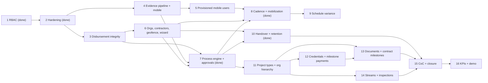
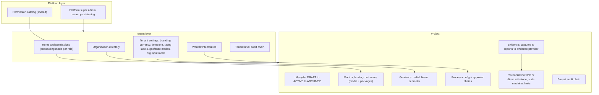

# InSite Assurance: SaaS Implementation Master Plan

**Last restructured:** 2026-11-18, after a full codebase review of `shared`, `server`, `web` and `mobile`.

This is the index for the SaaS programme. Each phase has its own plan file and is meant to be executed in a separate session. **If you are an agent starting a phase: read sections 2, 3 and 6 of this file, then your phase file. You do not need the other phase files.**

---

## 1. Where things stand

InSite Assurance is a field-evidence and drawdown-reconciliation platform for construction finance (see [project_context_current.md](../Project%20Context/project_context_current.md)). Three surfaces share one API:

| Workspace | Stack                                      | Role                                                                                                  |
| :-------- | :----------------------------------------- | :---------------------------------------------------------------------------------------------------- |
| `shared`  | TypeScript, Zod, Turf                      | Enums, request/DTO schemas, geofence maths, permission catalog. Single source of truth for contracts. |
| `server`  | Express, Prisma 7 (pg adapter), PostgreSQL | REST API under `/api/v1`, AI integrations (Azure OpenAI, Whisper), S3-compatible storage, PDF.        |
| `web`     | React, Vite, React Query, Tailwind 3       | Portal for monitors, lenders, contractors, tenant admins.                                             |
| `mobile`  | Expo / React Native, SQLite                | Offline-first field app: join project, capture evidence, end-of-day reports, telemetry.               |

**Phase 1 is implemented** (tenants, relational roles and permissions, project assignments, branding). The review found that Phase 1 left gaps, and that several pre-existing flows are unsafe or disconnected. The headline findings that shape this plan:

1. **Tenant isolation is incomplete.** Public registration lets anyone become a tenant super admin; five route groups have no project/tenant check; reconciliation endpoints trust IDs in the request body.
2. **The disbursement path has no guard rails.** No IPC state machine, client-supplied certified amounts and certifier identity, no amount limits, no segregation of duties.
3. **Mobile and reconciliation are not connected.** Reconciliation reads `FieldEvidenceLog`; the mobile app only writes `WorkdayReport` and chat messages. Evidence ratings run on seed data.
4. **Several integrity claims are not real** (perceptual hash, device signature, encrypted SQLite, face liveness), and some UI text asserts them as fact.
5. **Session revocation, tenant suspension and role edits do not take effect** because nothing re-checks them after a JWT is issued.
6. **The only Prisma migration predates Phase 1**, so a deploy would fail.

Phases 2 to 4 fix these before any new capability is added.

---

## 2. Decisions already made (do not re-open)

| #   | Decision                                                                                                                                                                                                                                                                 | Source                          |
| :-- | :----------------------------------------------------------------------------------------------------------------------------------------------------------------------------------------------------------------------------------------------------------------------- | :------------------------------ |
| A   | **The database is disposable during this programme.** Any phase may reset the dev DB, rewrite migrations and change the seed. No data backfills are needed.                                                                                                              | Owner, 2026-11-18               |
| B   | **Evidence ratings keep their four canonical meanings** (`SUPPORTED`, `PARTIALLY_SUPPORTED`, `UNSUPPORTED`, `CONTRADICTED`). Tenants configure only the display **label** and **description** for each. All logic, storage, AI prompts and APIs use the canonical value. | Owner, 2026-11-18               |
| C   | **Project creation is a multi-page wizard, one page per focus area, saved at every step.** A project is a `DRAFT` until the final step, which has a toggle to set it `ACTIVE`. Drafts are not live anywhere.                                                             | Owner, 2026-11-18               |
| D   | **Contractor selection includes choosing the contractor model** (multi-prime with separate IPCs, or main contractor plus subcontractors with a unified IPC).                                                                                                             | Owner, 2026-11-18               |
| E   | **Organisation inputs** (monitor, lender, contractors) can be free text or a dropdown of configured organisations, set per tenant. A monitor input is added.                                                                                                             | Owner                           |
| F   | **Geofence modes are configurable**: radial, linear corridor and perimeter (polygon).                                                                                                                                                                                    | Owner                           |
| G   | **Roles can be marked as pre-provisioned.** Users in those roles sign in to the mobile app with an account, see all their projects immediately, need no join code and skip identity assurance. Tenant super admins choose which roles.                                   | Owner                           |
| H   | **Approval chains are stored as relational tables, not JSON**, so steps have referential integrity and history.                                                                                                                                                          | Review recommendation, accepted |
| I   | **Hardening comes before features.** Phases 2 to 4 are prerequisites for everything after.                                                                                                                                                                               | Review recommendation, accepted |
| J   | **Programme delivery (Phases 11–16) is configuration, not client code.** The first programme client's answers are provisional and the target is a demo to fine-tune, so every client-specific rule is data on a project type or tenant setting, with today's behaviour as the default. | Owner, 2026-11-20 |
| K   | **Payments on programme projects are milestone payments** (fixed amount on verified completion, or measured), configurable per payment milestone. | Owner, 2026-11-20 (provisional) |
| L   | **One tenant per programme authority.** Delivery is owned by the flagship or a subsidiary organisation; subsidiaries are funded by the flagship. Visibility and approvals can follow that hierarchy. | Owner, 2026-11-20 (provisional) |
| M   | **Contractor mobilisation is measured from the kick-off date** (set in project creation), with a configurable number of days (21 Central, 14 Co-Funded by default). | Owner, 2026-11-20 |
| N   | **Professional registration is configurable** (required, optional or hidden) for certifiers and for field assurance, and every form, validation, message and PDF follows the setting. | Owner, 2026-11-20 |
| O   | **The Certificate of Completion is signed by organisation admins holding a configurable permission**, plus the beneficiary. Retention applies to programme contracts. | Owner, 2026-11-20 (provisional) |

---

## 3. Open decisions that need the owner

Only decisions that change how the platform is used are listed. Each has a default; if a phase starts before the owner has answered, **build the default and keep it easy to switch**.

| ID    | Phase | Question                                                                                                                                                           | Default if unanswered                                                                                                                                                    |
| :---- | :---- | :----------------------------------------------------------------------------------------------------------------------------------------------------------------- | :----------------------------------------------------------------------------------------------------------------------------------------------------------------------- |
| D-2.1 | 2     | Remove public self-registration so users are only created by a tenant admin or platform admin?                                                                     | Yes, remove it.                                                                                                                                                          |
| D-3.1 | 3     | Segregation of duties: may the same person certify a valuation and approve its disbursement? May super admins do either?                                           | Same user is blocked on the same IPC. Super admin roles do not hold certify/approve by default, and the platform super admin bypass does not apply to those two actions. |
| D-3.2 | 3     | If a mandatory Condition Precedent is not satisfied, is release blocked, or allowed with a recorded override?                                                      | Blocked, unless the CP is explicitly waived by a user with disbursement permission and a reason.                                                                         |
| D-4.1 | 4     | Which evidence pipeline is canonical: the end-of-day report the mobile app uses today, or per-capture AI extract/confirm?                                          | End-of-day report, with every photo and voice note registered as an individual verified capture underneath it.                                                           |
| D-4.2 | 4     | Contractor identity check: build real face liveness (needs a vendor SDK or a custom native build), or describe it honestly as a guided selfie reviewed by a human? | Guided selfie plus human review now; remove all "liveness verified" wording. Real liveness becomes a later, separate item.                                               |
| D-4.3 | 4     | Should GPS telemetry run in the background (battery cost, store-review scrutiny, extra permissions) or only while the app is open?                                 | Foreground only, plus a ping on every capture and report. UI wording changed to match.                                                                                   |
| D-8.1 | 8     | Which channel and provider sends reminders to people who have not installed the app yet (email, SMS, both)?                                                        | Email through a provider adapter, with a console adapter in dev. SMS added later.                                                                                        |
| D-12.1 | 12   | Do programme contracts pay a mobilisation advance that is recovered from later payments?                                                                            | Not built. Fixed and measured payment milestones only.                                                                                                                    |
| D-12.2 | 12   | Is the fixed payment basis needed with contractor IPC claims, not only direct milestone verification?                                                               | No: fixed basis is refused with IPC claims.                                                                                                                               |
| D-15.1 | 15   | How does the beneficiary sign the Certificate of Completion: through a secure public link, or on paper uploaded by staff?                                         | Paper copy uploaded and attested by staff; no new public surface.                                                                                                         |

---

## 4. Phase map

| Phase | Title                                                                       | Status                                                                           | Depends on        | Plan                                        |
| :---- | :-------------------------------------------------------------------------- | :------------------------------------------------------------------------------- | :---------------- | :------------------------------------------ |
| 1     | Multi-tenancy, branding and relational RBAC                                 | Implemented, with carry-overs                                                    | none              | [phase_1](phase_1_implementation_plan.md)   |
| 2     | Security hardening, tenant isolation and deploy baseline                    | Implemented, with carry-overs (see its section 7)                                | 1                 | [phase_2](phase_2_implementation_plan.md)   |
| 3     | Disbursement integrity, reconciliation workflow and rating labels           | Implemented, with carry-overs (see its section 7); web not yet clicked through   | 2                 | [phase_3](phase_3_implementation_plan.md)   |
| 4     | Field evidence pipeline and mobile sync reliability                         | Implemented; on-device testing pending (see physical_testing_checklist.md)       | 2 (3 recommended) | [phase_4](phase_4_implementation_plan.md)   |
| 5     | Provisioned mobile users and multi-project mobile                           | Implemented; web click-through and on-device testing pending (see its section 7) | 2, 4              | [phase_5](phase_5_implementation_plan.md)   |
| 6     | Organisations, contractor model, geofence modes and staged project creation | Implemented; web click-through and on-device testing pending (see its section 8) | 2, 3              | [phase_6](phase_6_implementation_plan.md)   |
| 7     | Process engine, standards, persona-aware AI and approval chains             | Implemented; web click-through and on-device testing pending (see its section 7) | 3, 4, 6           | [phase_7](phase_7_implementation_plan.md)   |
| 8     | Reporting cadence, late reports, mobilization and attendance alerts         | Implemented; web click-through and on-device testing pending (see its section 7) | 5, 6, 7           | [phase_8](phase_8_implementation_plan.md)   |
| 9     | Schedule variance and "Catch Project Up"                                    | Implemented; web clicked through; mobile on-device pending (see its section 7)  | 6, 8              | [phase_9](phase_9_implementation_plan.md)   |
| 10    | Stakeholder handover and retention management                               | Implemented; web clicked through; mobile on-device pending (see its section 7) | 6, 7              | [phase_10](phase_10_implementation_plan.md) |
| 11    | Delivery models: project types, organisation hierarchy, parties, terminology | Implemented; web click-through and on-device testing pending (see its section 7) | 6, 7              | [phase_11](phase_11_implementation_plan.md) |
| 12    | Configurable professional credentials and milestone payments                | Implemented; migrated and route-tested; click-through and on-device run pending (see its section 7) | 11                | [phase_12](phase_12_implementation_plan.md) |
| 13    | Document register, contract milestones, kick-off and mobilisation compliance | Implemented; migrated and route-tested; web click-through and on-device testing pending (see its section 7) | 8, 9, 11, 12      | [phase_13](phase_13_implementation_plan.md) |
| 14    | Monitoring streams, site inspection checklists, supervision workload       | Implemented; migrated and route-tested; web click-through and on-device testing pending (see its section 7) | 4, 8, 11          | [phase_14](phase_14_implementation_plan.md) |
| 15    | Certificate of Completion and closure governance                            | Implemented; migrated, seeded and route-tested; web dialogs not yet clicked through (see its section 7) | 10, 11, 12, 13, 14 | [phase_15](phase_15_implementation_plan.md) |
| 16    | Programme KPIs, configuration reference and end-to-end demo                 | Implemented; migrated, seeded and route-tested; web click-through, demo rehearsal and device runs pending (see its section 7) | 11–15             | [phase_16](phase_16_implementation_plan.md) |

Phases 11–16 come from the [process flow gap analysis](process_flow_gap_analysis.md) (Central and Co-Funded delivery models). Phase 14 can run in parallel with Phases 12 and 13 once Phase 11 is done.

Phases 3 and 4 can run in either order or in parallel sessions; they touch different files apart from one seam (the evidence provider, described in both plans). Phases 5 and 6 are likewise independent of each other.

### Where earlier plan items went

| Earlier item                                                                 | Now in          |
| :--------------------------------------------------------------------------- | :-------------- |
| Phase 1 open items 2.3, 7.2, 7.3 (apply schema, seed, functional checks)     | Phase 2, Step 0 |
| TD-P2-1 (unscoped access, revoked sessions)                                  | Phase 2         |
| TD-P2-3 (double-counted disbursement)                                        | Phase 3         |
| TD-P2-5 (mobile brief sync)                                                  | Phase 4         |
| TD-P2-2, TD-P2-4, TD-P2-6 and the rest of the old Phase 2                    | Phase 7         |
| Old Phase 3 (multi-contractor, AI contractor suggestion)                     | Phase 6         |
| Old Phases 4 and 5 (cadence, mobilization)                                   | Phase 8         |
| Old Phase 6 (schedule)                                                       | Phase 9         |
| Old Phase 7 (handover, retention)                                            | Phase 10        |
| New: configurable geofence, org dropdowns, monitor input, wizard with drafts | Phase 6         |
| New: rating labels                                                           | Phase 3         |
| New: provisioned mobile users                                                | Phase 5         |

---

## 5. Target architecture

---

## 6. Working conventions (all phases)

**Build and verify**

- Shared must be built before anything that imports it: `npm run build:shared`.
- Full check: `npm run typecheck` (root), `npm --workspace=@insite/server run test`, `npm --workspace=@insite/web run build`.
- Server tests use Node's test runner through `tsx --test src/tests/*.test.ts`. Phase 2 adds route-level tests against a test database; later phases add to that suite.
- Prisma 7 with `server/prisma.config.ts` and the `pg` adapter. After Phase 2 Step 0, schema changes go through `prisma migrate dev --name <phase_step>`. Never use `db push` after that point.
- The dev database can be reset at any time (decision A). Keep `server/src/db/seedDatabase.ts` working at the end of every phase.

**Contracts**

- Every request body and DTO is a Zod schema in `shared/src/schemas`, exported from `shared/src/index.ts`. Web and mobile import types from `@insite/shared`; do not hand-write duplicates in `web/src/api/types.ts` (existing duplicates are removed as phases touch them).
- New permissions are added to `SYSTEM_PERMISSIONS_CATALOG` in `shared/src/enums.ts` and granted to default roles in the single default-role definition (created in Phase 2).
- New audit actions are added to both the shared enum and the Prisma `AuditActionType` enum.

**Server patterns**

- Route files are thin: guard, validate, call a service. After Phase 2, every project-scoped router gets project access from one central middleware; do not add per-handler checks, and never read a resource by an ID from the body without confirming it belongs to the URL project.
- State changes that matter go inside one `prisma.$transaction` together with `recordAuditEvent`.
- Responses are built by explicit serializer functions. Never spread a Prisma row into a response.
- AI calls must record which engine produced a result and must never fabricate content when a provider is unavailable outside demo mode.

**Web patterns**

- `web/src/api/<area>` holds fetchers, `queries/<area>` and `mutations/<area>` hold React Query hooks. Mutation hooks own toasts (sonner); pages do not toast again.
- Gate UI with `hasPermission(...)` from `web/src/lib/auth-context.tsx`. Never infer a role from a combination of permissions or from a role code.
- Reuse `components/common` (for example `CustomSelect`) and `components/table/StandardTable`.
- Demo defaults and demo accounts must sit behind the demo flag and must not be in non-demo bundles.

**Mobile patterns**

- All persistence goes through `mobile/src/storage/*`. After Phase 4 there is one outbox; do not add new ad hoc queues.
- All client-generated IDs are UUIDs. Never send display strings, local `file://` paths or base64 blobs as record fields.
- Never show a verification state the app did not actually compute.

**Scope discipline**

- Do what the phase file lists. If you find a new defect outside scope, add it to the "Found during implementation" section at the bottom of your phase file rather than fixing it silently.
- Tick checklist items only when the behaviour is verified, not when the code is written.

**Context retention**
Update CLAUDE.md with relevant context about the changes made in each phase.
